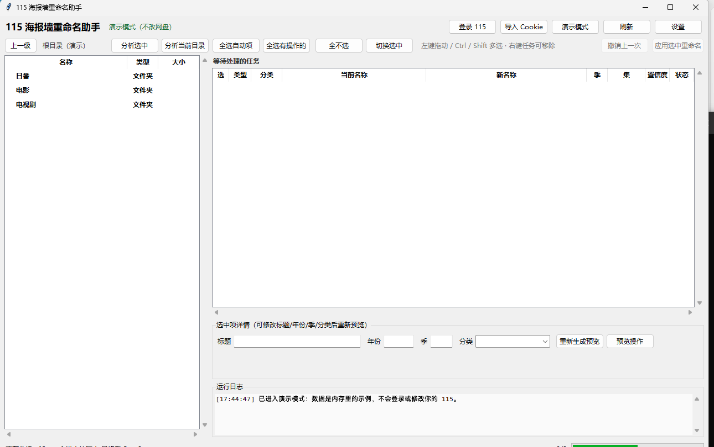

# 115 海报墙重命名助手

当前版本：**0.18**  
GitHub：<https://github.com/694185819/AutoRename115>

在 115 网盘中浏览你的电视剧、动画、番剧，自动搜索豆瓣、Bangumi、IMDb（可选 TMDB），
把不规则的文件夹/文件名改成 Emby、Jellyfin、Plex 容易刮削的格式。默认只重命名；
NFO/图片默认手动点“保存”才上传，也可以勾选“应用改名后自动存 NFO/图片”，
在确认改名时一并生成；清空操作移到 115 回收站。

左侧文件列表上方可以在 **网盘模式 / 本地模式** 之间切换。本地模式直接浏览
本机文件夹，同样支持分析、预览、勾选改名和撤销；不会上传、删除或移动文件，
NFO/图片只会写入本机对应文件夹。分析时仍会联网查询豆瓣/Bangumi/IMDb/TMDB。

设置 → 关于… 可以查看版本、仓库地址并检查在线更新；便携版会下载 GitHub
Release 中的新版本，退出后覆盖当前程序目录，保留 `data/`（登录、设置、撤销记录），
更新完成后自动重新启动。

程序启动约 5 秒后会自动检查一次 GitHub Release；运行期间每 2 小时再检查一次。
发现新版本会在窗口顶部显示更新提示条，可以直接查看/下载，也可以“忽略此版本”。
自动检查失败只在运行日志里记录，不弹错误框，也不会打断正在进行的扫描或改名；
可在“设置”里关闭自动检查。

自动匹配优先使用与本地标题/别名精确同名的条目；搜索接口顺带返回的模糊候选
只作兜底，并会经过本地标题校验，预览里不再把无关候选标题列出来。
目录中文名和视频日文别名不同（例如 `女子落语 [じょしらく]`）时，仍会把剧集
文件夹纳入改名；OVA/番外会单独列出。长副标题不会再被固定字数截断，
结尾的“真田小ZOO）”这类文字也不会被误当成发布组删掉。

## 0.18 更新摘要：豆瓣分集名 + 数据缺失可见

- **后台重建，不再卡死界面**：切换“按来源命名”、重新生成预览、季集映射、
  手动搜索后的重建都改到后台线程执行。以前这些重建在主线程里联网请求
  单集标题，网络一慢整个窗口就会无响应，并一直提示“当前有任务在执行”。
  现在点击立即返回，进度区显示处理中；忙碌期间再点只会记一条日志并提示
  “本次重建已跳过”，不再弹窗打断。

- **豆瓣也能取单集名**：豆瓣的分集页（`movie.douban.com/subject/<ID>/episode/N/`）
  有“本集中文名”，但它**需要登录**才返回内容。在设置里填入
  “豆瓣 Cookie”后，选“按豆瓣命名”就会读取分集页，把
  `S01E01.灯塔和光影会` 这样的副标题写进文件名。
- **取不到会明确告诉你**：以前某来源没有分集数据时是静默留空，看起来像
  “按来源命名没生效”。现在任务会提示
  `豆瓣 没有可用的单集标题数据（豆瓣分集页需要登录），副标题暂用原文件名`，
  并记下原因码 `name_source_no_episodes`。
- 豆瓣分集页被验证页拦截时整次放弃，不做无效连抓；未填 Cookie 时直接不联网。
- 新增 `work/tests/test_douban_episodes.py` 覆盖页面解析、只有标题页、验证页三种情况。

### 怎么填豆瓣 Cookie

1. 浏览器登录豆瓣，打开 `movie.douban.com`；
2. 开发者工具 → Network → 任意请求 → 复制请求头里的 `Cookie` 整串；
3. 软件 → 设置 → 粘贴到“豆瓣 Cookie”，保存；
4. 选中任务，勾选“按此来源命名”，来源选豆瓣，重新生成预览。

## 0.17 更新摘要：按来源命名

“影片资料”里新增 **「按此来源命名」** 勾选框。勾上后，这个任务的
**标题、单集副标题、特别篇（S00）顺序**都以你在上面选中的那个来源为准，
不再默认借用 TMDB：

- 不同来源对单集副标题、特别篇归属的看法不一致时（例如豆瓣把某集算特别篇、
  TMDB 把它排进第一季），按哪个来源命名就以哪个为准，不会被别的来源带走。
- 换来源时（点 IMDb / Bangumi / 豆瓣），命名来源会跟着换；取消勾选即恢复
  “自动匹配”。
- 各来源各自取数：TMDB 用季集接口；Bangumi 用条目的分集列表（按 sort 取
  正片集号，SP 不算正片）；IMDb 按 `季.集` 精确取标题。**某个来源没有分集
  数据时留空，改用原文件名里的副标题，绝不混入其他来源的标题**。
- 命名规则（日番简洁 / 中英+规格 / 电影）仍由分类决定，换来源不会改变格式。
- 来源条目本身也会作为备注写进任务，例如
  `命名来源：IMDb（条目 tt10827146）；标题、单集副标题与特别篇顺序按该来源。`

## 0.16 更新摘要

本版主要提升**自动匹配的准确度与可追溯性**，命名规则本身不变：

- **混合名称可匹配**：目录同时写中文名和英文/日文名（如 `异国日记 Ikoku Nikki`、
  `女子落语 [じょしらく]`）时，会按中英文分段分别比对，不再因为整串对不上
  而把正确条目当“无关候选”淘汰。
- **番外不再抢主条目**：OAD/OVA/番外/短片等近似条目会被降权，也不会被当成
  “精确同名”；标题相似度里的包含式打分按长度打折，减少“沾边就拿高分”的错配。
- **季号更可靠**：目录名没写季号、但文件名是 `S2E01` 时，季号会参与搜索与
  TMDB 季集校验；同一部剧的 `X` 与 `X 第二季` 不再被拆成多剧合集，
  文件夹能正常改名。
- **分类修正**：动画目录里放的真人剧（如《庆余年》）不会再被强行归成国产动画。
- **搜索诊断**：每次分析后，运行日志会出现
  `[搜索诊断] 目录名：搜索词 … / 豆瓣 … / Bangumi … / IMDb … / TMDB … / 置信度 …`，
  写明用了哪些搜索词、各来源第一名（名称｜年份｜ID｜得分）和最终置信度；
  同一段摘要也会写进任务备注，错配时可直接对照或截图反馈。
- **记住上次分析结果**：分析完成后保存到 `data/plans_cache.pkl`；下次启动
  （账号与文件夹都没变）自动恢复等待列表，并在后台逐项核对文件是否仍在
  原处，任何一项对不上就整批作废，不会在过期数据上改名。执行改名、撤销、
  切换根目录或清空列表后缓存自动作废。右键任务列表可手动
  “恢复上次分析结果（不联网）”，设置里可关闭。
- **任务详情显示原因**：需要确认的任务会在详情里显示
  `原因：置信度低、疑似重复集 …`，由结构化原因码渲染，不再靠解析提示文字。

内部同时完成了搜索匹配分层（打分 / 决策 / 文本规范化拆成独立模块）、
来源适配器扩展点，以及界面按面板与消息路由解耦。细节见
[架构优化大纲](docs/架构优化大纲.md)。

QQ 频道：**115资源互助小据点**（频道号 `pd75067698`）  
<https://pd.qq.com/s/c7b552021>  
在“设置 → 关于…”里点“二维码”即可按需查看扫码入口；点“在 QQ 中打开”会直接唤起
QQ 的频道页面，未安装 QQ 时自动回退到默认浏览器。



## 命名规则（按你的要求）

| 类型 | 文件夹 | 文件 |
|---|---|---|
| 日本番剧 | `[BD-REMUX]葬送的芙莉莲 葬送のフリーレン (2023) [imdbid-tt22248376]` | `葬送のフリーレン S01E01.旅立ちの町.mkv`（**日文名+SxxExx+副标题；不写规格**） |
| 电视剧 / 国产动画 / 美漫 / 欧美动画 | `庆余年 (2019) [imdbid-tt11273352]` | `庆余年.Joy.of.Life.S02E01.初入京都 [2160p WEB-DL].mkv`（**中英名+副标题+规格**） |
| 电影 / 动画电影 / 剧场版 | 保留原名 | `朝花夕拾[imdbid-tt...].mkv`；`[朝花夕拾 2018][imdbid-tt...].mkv`（**ID 放在中文名后，其他规格不变**） |
| 多集文件 | — | `Show.S01E01-E02.mkv` |
| 季目录 | `Season 01` / `Season 02` / `Specials` | — |
| 字幕/音轨 | — | 跟随视频改名，保留 `.zh`/`.chs` 等语言后缀 |

季条目会自动归到主剧名下，例如：

```
庆余年.第二季.2024.2160p.WEB-DL/      →  庆余年 (2019) [imdbid-tt11273352]/
  庆余年.第二季.S02E01.2160p...mkv    →    Season 02/  （若原目录已有季目录）
                                          庆余年.Joy.of.Life.S02E01 [2160p WEB-DL].mkv
```

- 电视剧/国产动画/美漫/欧美动画的副标题优先取原文件名 SxxExx 后面；没有时用 TMDB 单集标题；都没有就省略。
- 规格尽量保留原文件名里的分辨率、HDR/HDR10+/DV/Dolby Vision、编码、位深、音频编码、声道、fps、BT.2020/DCI-P3 等。
- 电影保留原名称和规格，只把 IMDb/TMDB 标识插到中文名或带 `[]` 的中文名后面；原来位置不对的 ID 会先删掉。
- 日番/国产动画/美漫的判断依据：所在文件夹（动画/美漫/美国动画/电视剧/电影/剧）、
  Bangumi 的地区/标签（`美漫`/`美国动画`/`美国` → 美漫）、TMDB 的动画类型
  （genre 16）和出品国、日文假名、豆瓣/Bangumi 条目；电视剧目录下的真人剧
  不会再因为地区是日本而被归成动画。美国动画归为“美漫”，英国/加拿大等
  归为“欧美动画”，命名规则相同。
  判断错了可以在界面里把“分类”改成“电视剧（中英+副标题）”“日番（简洁）”
  “美漫”“国产动画”或“欧美动画”。

### 日本番剧文件夹格式

设置里只保留两种：

| 选项 | 示例 |
|---|---|
| 标准 | `86 -不存在的战区 (2021) [imdbid-tt13718450]` |
| 你的风格（默认） | `[BD-REMUX]86 -不存在的战区 86―エイティシックス― (2021) [imdbid-tt13718450]` |

> 早期版本的“标签在后”和“不带年份”两种写法已从设置里移除；如果旧配置里
> 存的是这两种值，会按默认“你的风格”处理。

- “日番文件夹风格”启用时，新文件夹统一用 `[BD-REMUX]` 开头；
  原目录的 `[BDMV]`、`[BDISO]`、`[BDRip]` 只作为来源说明，不会搬到新名字开头。
- 命名前先读**原目录/文件名**里的中文、日文、英文名；已经有第二语言名时直接使用，不再联网取该名称。
- 原目录同时有中文名、日文名、年份和 ID 时，整部剧**完全不联网**；否则只联网补年份/ID。
- 原目录/文件名里已有 `[imdbid-...]`/`{tmdbid-...}` 时，会先用这个号查 TMDB 确认标题和年份（IMDb 号会反查）；ID 只作为查元数据的依据，最终仍按当前命名规则改名。
- 原目录没有第二语言名时，才查 Bangumi（日文原名），再查 IMDb/TMDB（英文原名），仍没有才只写中文名；不会重复写同一个标题。
- **IMDb 号放在末尾是可行的**，而且是最重要的刮削信号；`[BD-REMUX]` 开头不是标准刮削标记，所以 ID 和年份不能省。
- Jellyfin 用 IMDb 号需要 OMDb 插件；如果填了 TMDB Key，标识优先级选 `auto`/`tmdb` 会写 `[tmdbid-...]`，Jellyfin 原生支持，最稳。Emby 用 `[imdbid=...]`，Plex 用 `{imdb-...}`。

## 安全设计

- 默认只调用 115 的“重命名”接口；不移动、不下载。
- 本地模式只重命名本机文件，不删除、不移动；NFO/图片只在点击“保存”或
  勾选自动保存后写入本机。本地模式的“清空 NFO/图片”会直接禁用，
  避免误删。
- NFO/图片默认只在点击“保存 NFO/图片”并确认后上传；勾选
  “应用改名后自动存 NFO/图片”后，应用改名的确认框会提示并在改名成功后
  自动保存。清空 NFO/图片只移到 115 回收站，不永久删除，同样需要确认。
- 先分析 → 预览 → 确认 → 应用；默认只勾选“自动”项，“需确认”项必须你手动勾选。
- 每次应用都会写撤销记录，可一键“撤销上一次”（只改回名字仍然匹配的项目）。
- 文件扩展名保持不变（115 不允许改扩展名）。
- **115 风控保护**：请求默认放慢（读取约 0.45 秒、写入约 1.15 秒，
  批量改名每批最多 10 项、每批之间再随机停顿，NFO/图片每个约 1.3 秒）。
  如果 115 返回“操作频繁/触发风控”，程序会立即停止后续批次，
  冷却约 60 秒，期间不再请求 115，避免越点越糟；同一会话再次触发
  会延长冷却并进一步放慢后续请求。
- 首次启动（还没有登录 Cookie）会先显示风控提醒：不要频繁刷新、
  连续分析/改名或快速重复点击，否则可能出现手机端能登录、电脑/电视端
  暂时看不到文件的情况。提醒窗口可勾选“只显示一次”；取消勾选则下次
  启动仍会提示。
- 网络抖动或 115 临时异常不会被当成“登录失效”，不会反复弹扫码；
  只有接口明确返回登录失效/被踢下线时才提示重新登录。
- 115 同一设备类型会互踢。如果反复被踢下线，请在登录窗口换一个
  设备类型（例如 ios ↔ web）重新扫码；登录窗口会说明各自影响。
- “演示模式”完全使用内存里的示例数据，不登录、不联网、不改网盘。

## 安装与启动

### 方式一：直接用打包好的 EXE（推荐）

打开 `dist/AutoRename115/`，双击 `AutoRename115.exe`。

- 整个 `AutoRename115` 文件夹要一起复制，不能只拿 exe。
- 建议解压/复制到**可写目录**（例如 `D:\Tools\AutoRename115`），不要放在 `Program Files`，
  因为程序会在旁边创建 `data/` 保存 Cookie、缓存和撤销记录。
- 想先看效果：双击 `演示模式.bat`，或命令行运行 `AutoRename115.exe --demo`。

### 方式二：从源码运行

1. 安装 Python 3.10 或更高版本（安装时勾选 **Add Python to PATH**）。
2. 双击 `安装依赖.bat`，等待完成。
3. 双击 `启动.bat`。

如果双击没反应，运行 `调试启动.bat`，它会保留控制台窗口显示错误。
`data/error.log` 也会记录启动异常。

### 重新打包 EXE

双击 `打包EXE.bat`，输出在 `dist/AutoRename115/`。

## 使用步骤

### 1. 登录 115

- 点右上角 **登录 115**，用手机 115 App 扫码，手机上确认。
- 二维码过期就点“刷新二维码”。
- **扫码一次就会记住**：Cookie 会同时保存到程序目录的 `data/cookies.json`
  和 `%APPDATA%\AutoRename115\cookies.json`。以后换新版 EXE、换解压目录、
  重启电脑都会自动登录，不用重复扫码。
- 登录设备默认 **ios**：用安卓手机扫码也不会踢掉你的手机 App 或网页登录，
  而且 App 会话通常比网页耐用。
  - 如果选 **android**，可能踢掉你手机上的 115 App；
  - 如果选 **web**，可能踢掉浏览器里的 115 网页登录，而且会话较短。
  - 同一设备类型会互相踢下线。如果提示登录过期，再扫一次即可；
    也可以在登录窗口或设置里换设备。
- 也可以点 **导入 Cookie**：从浏览器开发者工具复制 115.com 的 Cookie，
  至少包含 `UID`、`CID`、`SEID`、`KID`。
- 设置里有 **退出登录**，会清除两处 Cookie。

### 2. 浏览并分析

- 左侧是 115 目录。双击文件夹进入，点“上一级”返回。
- **多选**：左键按住拖动可连续选中多行；Ctrl+单击可单独加/减；Shift+单击可连选。
  导航栏右侧会显示“已选 N 项”。
- **重命名**：右键单个文件/文件夹 → **重命名此项（立即生效）…**
  （也可以按 F2），只改这一项；文件扩展名不能改。改名会立即写入
  115，之后可以用“撤销上一次”恢复。右键菜单还可以进入文件夹、
  分析选中或刷新当前目录。
- **分析选中**：只分析选中的目录。
- **分析当前目录**：递归找出当前目录下的剧集/电影目录。

分析时会同时读取**当前文件夹和它的上级文件夹名**。如果进入番剧目录后
只剩 `00001.m2ts`、`00002.m2ts` 这类纯编号视频，程序会按编号识别成
`S01E01`、`S01E02`…，而不是当成多部电影；旁边的 `ass/`、`sup/` 字幕
目录也会按相同编号自动跟着改名。
中文名后面的英文/数字会保留为搜索词，例如 `攻壳机动队 SAC_2045`
会按完整标题搜索，不会只剩“攻壳机动队”而匹配到 2026 版。
`剧版《剑尘道魔录之玄劫天锋 2019》`、`剧版（某作品 2019）` 这类
目录，“剧版/真人版/动画版”只是版本说明，会取括号里的真剧名和年份，
不会拿“剧版”两个字去搜索（否则会命中“剧版超能陆战队”这类无关条目）。

季目录名前面带剧名、年份或规格也能识别，例如
`Overlord 2015 S01 JPN Blu-ray 1080p AVC LPCM 2.0` 会归到 S01。
`S2-美版暂无日语字幕sup`、`S1替换双语字幕` 这种“季号 + 说明”的目录
也会归到对应季，不会把“美版暂无日语字幕/替换字幕”当成另一部剧。
季目录本身不一定是片名：片名会继续从上级、上上级目录兜底；都没有就
留空并标“需确认”，不会拿 `S1替换...` 或字幕文件名去联网搜索。
如果季目录里的视频文件名和上级剧名明显对不上（例如把别的剧放进来了），
自动匹配会先停下并标“需确认”，不会把整季改成文件里那部无关的剧。
如果剧集根目录里同时放了 S01-S04 季目录和一个剧场版 ISO，会拆成
“剧集 + 电影”两个任务：剧集根目录按剧集格式改名，剧场版 ISO 单独按
电影格式改名，不会再把整个剧集根目录误判成电影。

合集根目录里同时有散装电影和**没有写 Sxx 的季目录**时，也会分别分析：
- 子目录直属视频里至少有两个集号文件，才认定为独立季目录；
- 季号从文件里的 `S1E01` / `S2E01` 读取，目录名没有 Sxx 也可以；
- 文件夹名会补上 `S01` / `S02`，例如
  `[BD-REMUX]希德尼娅的骑士 シドニアの騎士 S01 (2014) [tmdbid-60831]`；
- 最外层合集目录仍作为容器保留原名，散装电影各自生成电影任务；
- 字体、字幕、花絮目录不会被误当成季目录。

如果剧集目录里有 `tvshow.nfo`，电影目录里有 `movie.nfo`（或与视频同名的
`.nfo`），程序会先读取其中的：

- `<uniqueid type="tmdb">` / `<uniqueid type="imdb">`
- `<tmdbid>` / `<imdbid>`
- `<title>` / `<originaltitle>` / `<year>`

NFO 里的 ID 会优先用于查询，并用 NFO 标题校验，避免目录名残留 ID
把影片改错；NFO 没有 ID 时，标题和年份也会作为搜索词。NFO 读取失败
不会影响原来的联网搜索流程。

程序还会用 TMDB 的季集数做校验：
- 有 `Sxx` 标记但集号超过该季集数时，会在备注里提示核对；
- 文件没有季标记、集号又超过 TMDB 第一季集数时，会标记“需确认”，
  暂停集数改名，提示可能是“总集编号”，避免直接把第 13 集写成 S01E13。
  填好季号后点“重新生成预览”即可继续。

特别篇/第 0 集的识别规则：

- `OAD` / `SP` / `OVA` / `特别篇` / `Specials` 目录里的文件通常没有
  `S00E01` 这类集号，程序会先读取 TMDB 第 0 季标题，按标题/别名
  模糊匹配成 `S00E01`、`S00E02`…。
- 任意目录里写了 `SxxE00` 的文件会按 TMDB 特别篇里的“第0话/第0集”
  映射到 `S00E01`，不再因为“集号是 0”被跳过。
- 任意目录里带 `[Special]` / OVA / OAD / 特别篇 标记、但没有真正
  集号的文件（包括 `[Special]` 蓝光 ISO），会进入特别篇匹配；
  例如 `S1E00.m2ts` → `S00E01`，`[Special][JP].iso` → `S00E02`。
- 同名字幕/音轨会跟随，例如 `S1E00.zh-Hans.ass` 和字幕目录里的
  `... 00 ... .sc.sup` 都会变成 `S00E01...`。
- 匹配不到的文件才按文件名顺序补号。若只剩一个文件、TMDB 也只剩
  一个未用集号，会直接补上这个唯一编号并保持自动；仍有歧义时任务
  降为“需确认”，可用“季集映射…”核对。

例如南家三姐妹 OAD：
- `南家三姐妹 甜品别腹` → `S00E01`
- `南家三姐妹 久候多时` → `S00E02`
- `南家三姐妹 惬意暑假`（TMDB 夏日假期）→ `S00E03`

同一部剧/电影有多个版本目录时（例如 `测试剧 1080p` 和 `测试剧 4K`），
只要 TMDB/IMDb 身份、季集范围或电影视频数一致，就会归为同一组：
- 选一个主版本保留原名；额外版本**只改文件夹名**，在 ID 前加
  `V2`、`V3`，例如 `测试剧 Test Show (2020) V2 [tmdbid-100]`；
- 文件夹里的视频仍然正常命名，不会变成 `S01E01v2`；
- 已经有 `V2/V3` 的目录会保留原编号，不会重复叠加；
- 不同季的两个目录（如 S01 和 S02）不会因为 ID 相同而被误标版本。

只有一个目录、但同一集真的出现多个文件时，无法靠文件夹区分：规格不同的
会临时在视频名加 `v2` 防止撞名；规格相同的按“疑似重复/错集”处理，
任务降为“需确认”并取消自动勾选。

建议直接选中“日番”“电视剧”“电影”这类**剧集根目录**（例如 `日番/葬送的芙莉莲`），
不要只选 `Season 1`，否则程序不会改它的上级剧集文件夹名（但片名/年份仍会从
上级目录读取）。

### 3. 检查结果

右侧表格：

- 进度条已移到“等待处理的任务”右侧、任务表上方；会按
  **扫描/联网查询 → 重命名 → NFO/图片上传** 分阶段显示真实的 `x/y`。
  总数还没确定时只更新阶段文字，不再用来回抽动的不确定动画冒充进度。
- 登录、Cookie、设置、手动搜索、季集映射、改名、预览等程序弹窗
  都会在父窗口中央打开，不再跑到屏幕左上角。
- **选**：是否应用。绿色“自动”默认勾选，橙色“需确认”默认不勾选。
- **类型 / 分类 / 当前名称 / 新名称 / 季 / 集 / 置信度 / 状态**。
- 点某一行，下方显示：
  - 标题、年份、季、分类，都可以手动改；
  - 数据来源（豆瓣 / Bangumi / IMDb）和置信度；
  - 备注（例如“标题含最终季/Part，无法自动确定季号”）；
  - **影片资料**：单选切换豆瓣 / Bangumi / IMDb / TMDB，显示评分、封面、
    简介和演员（不是下拉框）；没有对应 ID 的渠道会自动禁用。
- 改完点 **重新生成预览**。例如“进击的巨人 最终季 Part.2”：
  在“季”里填 `4`，点重新生成，集数就会变成 `S04E01`。
- 自动匹配不对或没找到时，点 **手动搜索**（或右键任务 →
  **手动搜索正确条目**）：输入片名，点“搜索”会同时查询
  豆瓣/Bangumi/IMDb/TMDB，双击一条结果即可替换标题、年份和 ID。
  程序会自动尝试用该结果的原名/别名补齐 IMDb/TMDB 标识；
  当前分类不会被自动改动。
- 手动搜索窗口上方会列出从任务/文件名拆出的**可点击关键词**：
  本地目录名优先，例如 `攻壳机动队 SAC 2045` 会完整保留；
  `01.m2ts`/`02.m2ts` 这类文件序号不会混进去。自动匹配的英文名/
  别名只有和本地标题对得上时才作为补充，匹配错的别名不会带偏搜索。
  关键词用普通文字显示（`·` 分隔），不是一排按钮。
  中文主标题、副标题、英文名、`S02`、`第二季`、`Season 2` 等。
  点一下就能换关键词搜索，不用手动删改长文件名。
- 选中一条搜索结果后，下方会显示类型、地区、首播/上映日期、
  TMDB 评分和简介，方便区分同名电影/剧集、真人版/动画版。
- 搜索窗口把 **豆瓣 / Bangumi / IMDb / TMDB** 四个来源固定显示成按钮，
  按钮上带结果数量；点 IMDb 就只显示 IMDb 的结果，点“全部”恢复。
  搜索本身会同时查询全部可用来源，切来源只过滤当前结果，不重新联网。
- 搜索结果上方还可以按 **类型（剧集/电影/未知）、内容（动画/真人/未知）、
  地区** 筛选；结果表会多出“内容/地区”两列。筛选只影响显示，不会改动
  元数据；来源没有明确地区/类型时显示为空，不会乱猜。选中地区/内容后，
  提示行会显示被隐藏的未知项数量，可把对应筛选切到“未知”查看。
  Bangumi 搜索结果会自动补一次详情（30 天缓存），补出地区并识别
  剧场版，因此地区筛选和“电影/剧集”判断更准确。点“重置筛选”恢复全部。
- 选中剧集任务后，详情里的 **“季集映射…”** 可以：
  - 列出任务里的所有视频和自动推断的季/集；
  - 选中一个或多个文件，设置季号和起始集，集号按顺序递增；
  - 一键“总集数自动分季”，按 TMDB 各季累计集数把 E13 分到 S02E01；
  - 用红色标出“疑似重复”、蓝色标出“多版本”，避免混淆；
  - 只重建预览，不直接改网盘。
- 自动搜索和手动搜索都启用了**模糊搜索**：会同时尝试主标题、英文名、
  `第N季 / Season N / S0N` 等变体，并合并结果；豆瓣搜索结果不完整时
  会自动读取豆瓣搜索页补全四季。季号明确时会优先匹配对应季，避免
  “第四季”任务被“第三季”条目抢走。
  自动搜索只使用有来源的搜索词：当前目录自己的名称/别名，以及真正
  提供片名的那一级上级目录；`其他布袋戏（全系列）`、`布袋戏系列`
  这类合集容器名不会混进来。字幕/音轨文件名不参与片名搜索；季目录里
  的视频文件名如果和上级剧名冲突，匹配结果还必须同时支持两边，否则
  任务会标“需确认”，不会自动改名。
  自动候选还要通过本地锚点校验：候选标题/别名必须和本地标题有真实的
  文字重合，完全同名的候选优先；电影候选年份差超过 1 年时先排除。
  只靠“剧版/影版/第一季”这类前缀拿到的高分不会再被自动采用；没有
  合格候选时就停下来标“需确认”。
- **全选有操作的** 会选中所有能改的项（包括蓝光 BDMV 的“需确认”项），
  适合批量处理大量 BDMV 外层文件夹。
- 点 **预览操作** 查看完整的“旧名 → 新名”列表。列表最前面有
  **“选”** 列，打开时默认全选；点一下可单独取消某个文件夹/文件，
  底部会显示“已选 N/M”，也可以“全选/全不选”。应用选中重命名时
  只处理勾选的项目；没勾选的保持原名，NFO/图片也不会按它的新名生成。
- **保存 NFO/图片**：为当前任务生成 Kodi/Jellyfin 格式的
  `tvshow.nfo`、每集同名 `.nfo`、`poster.jpg`、`fanart.jpg` 并上传到 115；
  已有 `.nfo`/图片按设置“跟随媒体改名”或“删除后重存”，只补齐缺失文件。
  旁边的 **应用改名后自动存 NFO/图片** 勾选后会记住：以后每次确认
  “应用选中重命名”，都在改名成功后自动执行同样的保存流程，
  不需要改完再回头找任务。自动保存只在改名全部成功时执行；
  如果部分文件改名失败，会跳过该任务并在提示里说明。
- **清空 NFO/图片…**：可选“所选任务”或“当前文件夹”范围，只处理
  能匹配到视频名的 `.nfo`/图片并移到 115 回收站（可恢复）。
  电影库根目录有多部电影时，不会误删其他电影的资料。
- 右侧是“等待处理的任务”。不想要某一项时，**右键任务 → 从等待列表移除**
  （只清界面，不会动网盘），也可以按 Delete。右键菜单还有“清空等待列表”。
- 想单独改某个名字、不跑批量规则：**右键任务 → 临时改名（立即生效）**，
  选一项、改好名字点“立即改名”。会马上修改 115 上的名字，只改这一项；
  改完后该项从等待任务里移除（相关字幕也会一并移除，避免名字对不上）。

### 4. 应用

勾选要处理的行，点 **应用选中重命名**。确认框会列出前几条改名示例。
只改名字，不动文件内容。失败的项目会在提示里列出来。
如果事先勾选了详情里的 **应用改名后自动存 NFO/图片**，确认框会提示，
改名成功后会继续为这些任务生成并上传 NFO/图片；有失败项的任务会跳过
自动保存，并在结果提示里说明。

### 5. 撤销

改错了点 **撤销上一次**。程序会先核对当前名字是否还是上次改成的名字，
名字已经手动变过的项目会跳过，不会误改。

## 设置

- **标识写法**：
  - `jellyfin`：`[imdbid-tt...]` / `[tmdbid-...]`
  - `emby`：`[imdbid=tt...]` / `[tmdbid=...]`
  - `plex`：`{imdb-tt...}` / `{tmdb-...}`
  - `none`：不写标识
- **标识优先级**：
  - `auto`：有 TMDB ID 就写 TMDB，否则写 IMDb
  - `tmdb` / `imdb`：强制优先某一种
- **TMDB API Key（可选）**：填了会多一个 TMDB 数据源，并允许写 `[tmdbid-...]`。
  设置窗口的输入框下方有“获取 TMDB API Key”入口，会打开
  https://www.themoviedb.org/settings/api 。
  Jellyfin 自带 TMDB 提供器，**TMDB ID 是 Jellyfin 最稳的方式**；
  IMDb ID 需要 Jellyfin 安装 OMDb 插件并配置 Key。
  Emby 和 Plex 原生支持 IMDb ID，可以不填 TMDB Key。
- **使用 Bangumi**：默认开启，对日番/国产动画/美漫的中文名、原名、别名，
  以及“美国/美漫/美国动画”这类地区标签识别最准；关掉后美漫仍可按
  目录名、TMDB 类型/出品国判断。
- **同步重命名字幕/音轨**：默认开启，只改能和视频对应上的字幕。
- **应用改名后自动存 NFO/图片**：默认关闭，在详情里的 NFO/图片按钮旁勾选。
  勾选后会记住；每次确认“应用选中重命名”并全部改名成功后，会继续生成
  并上传 NFO/图片。部分改名失败的任务会跳过自动保存并提示原因。
- **季目录改名**：默认开启，把 `第一季`/`Season 1` 改成 `Season 01`（只改名，不新建）。
  季号也支持 `Season II`、`Ⅱ`、`第Ⅱ季`、`第Ⅱ部` 等罗马数字写法。
- **单独分析某一季**：如果根目录本身带季号（如 `S02`、`第二季`、`Season 2`），
  剧集文件夹名会在中文名后加 ` S02`：
  `降世神通：最后的气宗 S02 (2005) [imdbid-tt0417299]`。
  整部剧根目录（里面还有多个季子目录）保持 `中文名 (年份) [ID]`，不加季号。
- **剧集文件夹统一格式**：`中文名 英文名 Sxx (年份) [ID]`，
  例如 `假如...? What If S02 (2021) [tmdbid-91363]`。
  没有英文名时省略英文；日番仍按你的 `中文名 日文名` 风格。
- **剧集名强制使用联网元数据**：中英文名、主剧 ID 以联网匹配结果为准，
  不再从本地文件名猜英文名；联网没拿到剧名时任务会标记“需确认”，
  不会用本地文件名硬改。

## 海报墙刮削建议

- **Jellyfin**：剧集库选“节目”，电影库选“电影”；元数据语言设为 `zh-CN`；
  开启 TMDB；如果想用 IMDb ID，安装 OMDb 插件并填 Key。
  最省事的组合：在本软件设置里填 TMDB Key，标识优先级选 `auto` 或 `tmdb`。
- **Emby**：设置里标识写法选 `emby`；Emby 原生支持 `[imdbid=tt...]`。
- **Plex**：标识写法选 `plex`；使用 Plex Movie / Plex TV Series 代理。
- 文件夹名保留中文标题，同时带 ID；即使标题和数据库略有差异，ID 也能兜底。

## 数据与缓存

全部在软件目录的 `data/` 下：

| 文件 | 作用 |
|---|---|
| `cookies.json` | 115 登录 Cookie（请勿分享）；同时备份到 `%APPDATA%\AutoRename115\cookies.json`，换版本不丢登录 |
| `metadata_cache.json` | 豆瓣 / Bangumi / IMDb / TMDB 查询缓存，可删除 |
| `undo.json` | 最近 20 次撤销记录 |
| `settings.json` | 界面设置（可能含 TMDB API Key，请勿分享） |
| `plans_cache.pkl` | 上次分析结果的本地快照，用于启动时恢复等待列表；改名/撤销/换根目录后自动失效 |
| `local_index.json` | 本地模式的文件索引 |
| `update.log` | 在线更新时的日志（仅在更新失败时产生） |

`data/` 目录**不包含在便携包里**，也不会随代码上传。打包与上传脚本都排除了
`data/`、Cookie、设置和缓存。

## 已知限制

- **豆瓣限流**：连续分析很多剧时，豆瓣可能返回空数组。程序会自动降速，
  并用 Bangumi / IMDb 兜底；也可以过几分钟再试。缓存会保留已经查到的结果。
- **115 网页版接口**：属于非官方接口，如果 115 改版，可能需要更新。
- **BDMV / VIDEO_TS 蓝光目录结构**：只会重命名最外层文件夹（标题/年份/ID），
  内部 `BDMV/STREAM` 等结构文件保持原样；这类方案固定标为“需确认”，默认不勾选。
  若外层同时有散装 `.m2ts`，散装文件会正常改名，BDMV 结构不动。
  ISO、M2TS、MKV、MP4 等单文件正常。
- **季数无法自动判断**：标题含“最终季”“Part.2”“后半”等，程序不知道对应第几季，
  会标成“需确认”并且不生成集数改名；请在详情里手动填季。
- **全汉字日文标题**（如《呪術廻戦》）如果 Bangumi 也没给出地区信息，
  可能被当成电视剧而带上规格；在分类里改回“日番（简洁）”即可。
  目录名里带日文假名的，会自动判为日番。
- **重名冲突**：同一目录下目标名重复时会中止并提示，请先处理同名文件。
- 只选中季目录时，不会改上级剧集文件夹名；建议选剧集根目录。
- 目录名里已有的 `{tmdbid-...}`、`[imdbid-...]` 会先核对标题；标题对得上才保留，
  明显是别的剧/别的季的 ID 会被忽略，改回主剧 ID。

## 项目结构

```
AutoRename115/
├─ run.py                 启动入口
├─ app/
│  ├─ models.py           数据模型
│  ├─ parser.py           文件名解析（季/集/年份/字幕组/规格）
│  ├─ textnorm.py         标题规范化、季号解析（纯文本工具）
│  ├─ scoring.py          候选打分、锚点校验、主条目/IMDb 挑选
│  ├─ decider.py          由各来源候选决定最终匹配结果、主剧还原
│  ├─ metadata.py         各来源请求（豆瓣/IMDb/Bangumi/TMDB）、缓存与限速
│  ├─ sources/            元数据来源扩展点（SourceAdapter 协议 + 注册表）
│  ├─ qc.py               任务质量检查原因码（需确认/跳过的结构化原因）
│  ├─ p115.py             115 扫码登录、列目录、批量重命名（含演示客户端）
│  ├─ planner.py          分类、命名规则、版本目录、改名方案
│  ├─ episode_versions.py 同集多文件：多版本/疑似重复判定
│  ├─ episode_mapping.py  手动季集映射窗口
│  ├─ manual_search.py    手动搜索与地区/类型筛选
│  ├─ nfo.py              NFO/图片生成、匹配与跟随改名
│  ├─ undo.py             撤销记录
│  └─ gui.py              Tkinter 界面（按面板与消息路由拆分）
├─ work/tests/            开发测试（不影响使用）
├─ docs/
│  ├─ screenshot.png
│  ├─ 刮削优化路线.md
│  └─ 架构优化大纲.md
├─ dist/AutoRename115/    打包好的可运行目录（EXE + 依赖）
├─ requirements.txt
├─ 安装依赖.bat
├─ 启动.bat
├─ 演示模式.bat
├─ 调试启动.bat
└─ 打包EXE.bat
```

## 开发与测试

- 离线回归测试在 `work/tests/`，逐个运行即可，例如
  `.venv\Scripts\python.exe work\tests\test_scoring.py`。
- 其中 `test_gui_real_listing.py` 需要真实的 115 登录与网盘目录，
  其余用例都可以离线运行。
- 测试与源码的边界：`textnorm` / `scoring` / `decider` / `qc` 都是纯函数模块，
  新增规则时优先在这些模块的测试里锁定行为。

