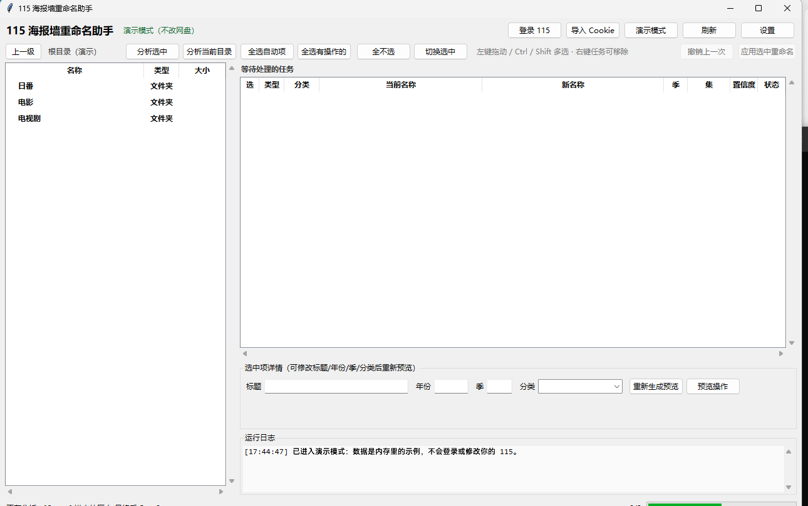

# 115 海报墙重命名助手

当前版本：**0.45**
GitHub：<https://github.com/694185819/AutoRename115>
下载：<https://github.com/694185819/AutoRename115/releases/latest>

把 115 网盘里不规整的影视文件，一键改成 **Emby / Jellyfin / Plex**
能正确刮削的名字。

## 它能做什么

| 功能 | 说明 |
|---|---|
| **规范命名** | 中文名 + 英文名 + `SxxExx` + 副标题 + 规格，适配海报墙 |
| **元数据匹配** | 自动搜索 豆瓣 / Bangumi / IMDb / TMDB（TMDB 需自备 API Key） |
| **四种命名分类** | 日番（简洁）/ 国漫 / 电视剧（带规格）/ 电影，规则各不同 |
| **多季合并** | 父目录下多个季目录自动合并为一个任务，季目录改为 `Season 01/02` |
| **字幕管理** | 简日/繁日/简体/繁体自动识别；多份字幕触发确认机制，避免覆盖 |
| **NFO / 图片** | 可手动或改名后自动上传；清空走 115 回收站 |
| **本地模式** | 直接处理本机文件夹，不上传不删除 |
| **撤销** | 改名失败或改错可一键撤销 |

## 命名规则速览

**日番**——文件夹承载身份，文件名保持简洁：

```
文件夹： [BD-REMUX]葬送的芙莉莲 葬送のフリーレン (2023) [tmdbid-209867]
视频：   葬送のフリーレン S01E01.冒险的结束.mkv
字幕：   葬送のフリーレン S01E01.简日.sup
```

**普通剧集**——文件名带英文名段与规格：

```
文件夹： 青云志 The Legend of Chusen (2016) [tmdbid-67814]
视频：   青云志.The.Legend.of.Chusen.S02E01.救碧瑶小凡赴空桑 [2160p WEB-DL h265 AAC 2.0].mkv
```

命名规则里的「英文名段」可选：不显示 / IMDb / TMDB / 豆瓣 / Bangumi / 本地。
选「不显示」就不写该段；选哪个来源就只用那个来源的名字，不会混用。

## 字幕语言标记

多份字幕会被自动识别并统一成简洁中文标签：

```
JPSC / jps / 简日        → 简日
JPTC / jpt / 繁日        → 繁日
chs / sc / zh-Hans / 简  → 简体
cht / tc / zh-Hant / 繁  → 繁体
JPN / ja / jap           → 日语
```

同一集出现 **2 份及以上且语言不同** 的字幕时，程序**不会自动改名**，
而是在预览窗口左下角弹出「多字幕设置」区，按集分组勾选后再确认。
单份字幕照常自动重命名。

## 0.35 更新摘要：字幕同层规则 + 多字幕机制

**字幕只在「与视频同层」时参与命名**

以前剧目录下 `ass/`、`sup/` 里的归档字幕会被收进任务，
触发多字幕确认区（36 份），视频反而没处理好。现在：

| 情况 | 结果 |
|---|---|
| 字幕与视频同在一个文件夹 | 跟随视频改名 |
| 字幕在独立目录、视频在季子目录 | **不参与** |

配套四条保护：
1. 选中目录整棵子树没有视频 → 直接忽略，不搜索
2. 字幕目录永远不当季目录
3. 字幕要能对上视频（集号 + 剧名校验）才被收集
4. 视频没改名时，字幕/音轨保持原名

**多字幕机制（三重锁）**

同一集有 2 份及以上不同语言且与视频同层的字幕时：
- 自动检测：简繁双语 / 简繁双体 / 三字幕
- 人为确认：预览窗口左下角按集分组勾选
- 预览修改：点「按选择命名」实时写回

**字幕名简化**

```
视频：雨と君と S01E01.mkv
字幕：雨と君と S01E01.简日.sup
      雨と君と S01E01.繁日.sup
```
语言标记统一成中文（JPSC→简日、chs→简体、JPN→日语…）。

**预览窗口全面可滚动**：多字幕区独立滚动、按钮固定、
表格垂直+水平双向滚动。

**强制重搜准确度**：候选汇总 + 分数门槛 0.45 + 年份校验 +
中置信度弹窗确认。

---

## 历史更新摘要

## 0.45 更新摘要

## 本版修复

### 有视频的文件夹不再因「名字不像」被跳过

```
[BD-REMUX]花开伊吕波[花咲くいろは]/
    日版TV/                    ← 26 个 花咲くいろは S1E01~E26.m2ts
    [剧场版 ...].iso
    剧场.sup
```

**以前**：分析父目录只出 1 条电影任务，`日版TV` 里 26 集视频被完全忽略。

**原因**：判断子目录是不是剧集时，先用目录名做否决——

```
目录名含 Season/S1/TV… ？  否
与父目录标题相似？        否（「日版TV」vs「花开伊吕波」相似度 0）
  → 直接 return False，连目录内容都没读
```

而里面 26 个文件的片名和 `S1E01` 集号都写得清清楚楚。

### 改为纯内容判定

名称**完全不参与**判断（`BDMV`/`VIDEO_TS` 这类文件系统结构目录除外）：

```
读目录 → 有 ≥2 个视频，且带集号的占多数 → 是剧集，分析
                                        → 否则跳过
```

这是早前为字幕夹定下的原则的延续：**判断依据只能是内容，不能是名字**。
多轮往提示词里加 `TV`/`正片`/`日版` 都只是打补丁，名字永远列不全，
换个 `B版`、`内嵌`、`Ver.2` 就会再漏。

### 验证

14 个任意名称全部正确识别 26 集：

```
日版TV  正片  本篇  无修版  连载版  A盘  第一份
B版  内嵌  Ver.2  临时  a  123  乱七八糟
```

防误判同样有效：

| 情况 | 结果 |
|---|---|
| 空目录 | 不认 |
| 单个无集号视频（`制作花絮.mkv`） | 不认 |
| 单个带集号视频（`S1E01.m2ts`） | 认作剧集（原有行为） |

### 日志

现在会说明判定依据，方便确认软件为什么这样分：

```
「日版TV」内含 26 个带集号的视频（共 26 个），按剧集分析。
```

### 代价说明

分析合集目录时，每个子目录会多一次列表请求。115 读取间隔 0.45 秒，
20 个子目录约多 9 秒。用这点时间换取判定正确。

## 回归

快速模式 36/36 通过。
`test_nested_content.py` 覆盖任意名称识别与三类防误判。


---


## 0.44 更新摘要

## 本版重点：迁移到新的发布仓库

### 1. 安装包搬到了新地址

今后所有版本发布在新的仓库：

**https://github.com/694185819/AutoRename115-release**

源码不再和安装包放在一起，安装包仓库只放 exe、SHA256 和说明。

### 2. 旧用户如何迁移

旧版本的 exe 里写死了老地址，改不了。所以本次做了两件事：

- 本版（v0.44）起，软件改为检查新仓库的更新
- 旧仓库的最新 Release 说明里插入了迁移提示，**旧版用户检查更新时
  会看到弹窗**，引导到这里下载

**旧用户只需要手动下载安装一次，之后就恢复自动更新。**

### 3. 「关于」窗口调整

```
版本 0.44
构建：v0.44 · xxxxxxxx · 2026-11-04 ...
下载地址：https://github.com/694185819/AutoRename115-release
项目主页：https://github.com/694185819/AutoRename115
```

下载地址与项目主页分开显示，避免用户从源码页找安装包。

### 4. 反盗版声明

新增 `LICENSE`（保留所有权利，禁止商业使用、修改再分发、反编译、
移除版权标识）。软件**不是开源软件**，源码公开不构成使用授权。

## 回归

快速模式 27/27 通过。


---

## 0.43 更新摘要

## 本版新增

### 许可协议（LICENSE）

明确使用边界：

- **允许**：个人免费使用；原封不动转发原始安装包、不收钱、保留版权标识
- **禁止**：商业使用、修改改编、反编译逆向、移除版权与构建标识、改名换作者后重新发布

本软件**不是开源软件**。源代码公开仅供参考学习，不构成任何使用授权。

### 构建指纹

打包时自动写入 `data/build.json`：

```json
{
  "version": "0.43",
  "build_id": "44639e4e184fd57e",
  "built_at": "2026-11-04 02:34:56",
  "copyright": "(C) 2026 694185819. All rights reserved."
}
```

「关于」窗口新增一行**构建**信息，点击可复制：

```
构建：v0.43 · 44639e4e184fd57e · 2026-11-04 02:34:56
```

用途：用户报告问题时粘贴这行就能对应到唯一一次构建；源码运行显示
「开发版（源码运行）」，与官方包可区分；他人重打包对不上指纹。

### 发版脚本自检

打包后自动校验两件事，不通过就中止：

- 压缩包里必须有 `data/build.json`
- 压缩包里**绝不能**混入 `settings.json` / `cookies.json` 等凭据文件


---


## 0.42 更新摘要

## 本版新增

### 手填渠道编号：渠道没收录也能直接用

「资料来源」那一行下面多了一整行编号输入框（**平时隐藏**，不占地方）：

```
资料来源  ○豆瓣  ○Bangumi  ○IMDb  ◉TMDB   该渠道没有可用 ID
[______________] 填 TMDB 的条目编号，回车套用
```

| 操作 | 结果 |
|---|---|
| 平时 | 不显示 |
| 点击已选中的来源（重搜） | 输入框出现，光标自动进入 |
| 填编号 + 回车 | 写入该来源 ID，日志绿字提示，按编号取回条目 |
| Esc | 收起 |
| 切换到别的来源 | 自动收起，避免误填到错渠道 |

编号会自动清洗，粘贴整条网址也行：

| 渠道 | 你填的 | 实际采用 |
|---|---|---|
| TMDB | `216272` | `216272` |
| IMDb | `https://www.imdb.com/title/tt24326724/` | `tt24326724` |
| 豆瓣 | `35615867` | `35615867` |
| Bangumi | `410939` | `410939` |

空值或非法输入不会把已有 ID 写坏。

**解决什么问题**：以前某个渠道搜不到这部作品（例如 TMDB 没收录），
只能看到「该渠道没有可用 ID」，没有任何补救手段。现在去网站找到编号
填进来回车即可，不用再靠标题去撞运气。

## 回归

快速模式 27/27 通过；新增 `test_manual_source_id.py`
（覆盖平时隐藏/重搜出现/四种渠道编号清洗/非法输入不写坏/切换收起）。


---

## 0.41 更新摘要

## 本版修复

### 1. 「特别篇」目录不再被当成片名去搜

单独选中 `[BD-REMUX]黑执事 Black Butler (2008) [tmdbid-50712]/特别篇系列`
分析时，以前会：

```
片名取自当前文件夹名：特别篇
搜索 豆瓣：'纳米核心 特别篇'
搜索 豆瓣：'万圣街 特别篇 古堡的秘密'     ← 搜出了完全无关的剧
```

而且父目录明明带着 `[tmdbid-50712]`，却因为标题对不上被丢弃。

**三处根因：**

| # | 问题 |
|---|---|
| ① | `特别篇系列` 去掉尾部「系列」后成了 `特别篇`，被当成真片名 |
| ② | `_existing_ids()` 要求上级目录标题与片名一致才采用 ID，`特别篇` 对不上 `黑执事` → 父目录 ID 被丢 |
| ③ | `_usable_query('特别篇')` 返回 True，还能继续派生 `特别篇 2008` 等变体 |

**修复**：新增 `is_specials_dir()`，识别 `特别篇/特別篇/Specials/SP/OVA/OAD/番外/特典`
（先去掉「系列/合集」尾巴再判断，所以 `特别篇系列` 算、
`[BD-REMUX]最终流放系列` 不算）。

- 特别篇类词**永不当搜索词**
- `_context_parsed()` 遇到特别篇容器时往上取片名
- `season_from_dir()` 判为第 0 季（season=0）

**修复后实测：**

```
搜索过的词: []
按 ID 匹配: [('', '50712', '黑执事')]        ← 直接用父目录编号
  season  | 特别篇系列  -> Specials
  episode | S00E01.m2ts -> 黑执事.Black.Butler.S00E01.那名执事.工作.m2ts
  ...
```

`S00E*` 集号方向以文件名为准，不重新推断。

**顺带**：分析父目录时，`Season 01` 与 `特别篇系列` 会合并成同一个任务
（季号 1 和 0），`特别篇系列` 改名为 `Specials`。
以前它会因为「系列」二字被拆成两部不同的剧。

### 2. 任务完成改为日志绿字，不再弹窗

| 情况 | 以前 | 现在 |
|---|---|---|
| 重命名全部成功 | 弹「已完成 N 个重命名」 | **日志绿字** |
| NFO/图片保存完成 | 弹窗 | **日志绿字** |
| 清空 NFO/图片完成 | 弹窗 | **日志绿字** |
| 没有需要改名的项目 | 弹窗 | 普通日志 |
| **有失败 / 疑似 115 风控** | 弹窗 | **仍然弹窗**（含逐条原因与等待建议） |
| 需要你做决定（选资料源等） | 弹窗 | 仍然弹窗 |

日志新增两种颜色：绿色 `#1a7f37` 表示完成，红色 `#c62828` 表示失败。
连续批量操作不再被弹窗打断。

### 3. 顺带修正的测试

| 测试 | 说明 |
|---|---|
| `test_specials_folder`（新增） | 覆盖上述两个场景，已加入快速回归 |
| `test_fuzzy_search` | 季号变体去重后的新行为（`第4季`/`S04` 不再重复搜） |
| `test_ancestor_context` | 字幕在 `ass/`、`sup/` 子目录按「同层才改名」应为 0 项 |
| `test_nested_season_dirs` | 季目录下「字幕/」同理 |
| `test_auto_nfo_apply` | 修复 `after(250, _startup)` 清空消息队列导致的假失败 |

### 4. 回归脚本自动重跑

并行测试偶发因 CPU 争用失败（单独跑却是好的）时，自动串行重跑一次；
重跑通过则记为通过并打印 `[重跑通过]`，消除噪声。

## 回归

快速模式 26/26 通过（约 36 秒）；
全量 112 个测试，111 通过（仅 `test_gui_real_listing` 需实时 115 网盘）。


---

## 0.40 更新摘要

## 本版新增

### 点击封面跳转网页

「影片资料」里的封面现在可以点击，用系统默认浏览器打开**当前所选资料
来源**的条目页：

| 来源 | 打开的地址 |
|---|---|
| 豆瓣 | `movie.douban.com/subject/{编号}/` |
| Bangumi | `bgm.tv/subject/{编号}` |
| IMDb | `imdb.com/title/{tt编号}/` |
| TMDB | `themoviedb.org/tv/{编号}`（电影自动用 `/movie/`）|

切换「资料来源」单选按钮后，点击封面打开的地址会跟着变。

### 鼠标跟随提示

鼠标移入封面范围时：

- 出现一个小提示「**点击跳转网页**」，贴在鼠标右下方并**跟随鼠标移动**
- 光标变成手型
- 移出封面提示立即消失
- 当前来源没有条目编号时**不显示提示**，避免误导

### 实现说明

- 只在真的能跳转时才提示，避免「点了没反应」
- 打开失败会弹出错误提示，并把地址写进运行日志
- 提示窗口不抢焦点、不拦截点击，不影响正常操作

## 回归

快速模式 25/25 通过（约 30 秒）。
新增 `test_poster_link.py`：覆盖四个来源的 URL 拼接、点击触发、
提示跟随与消失。


---

## 0.39 更新摘要

## 本版修复

### 1. 搜索请求量大幅下降

一次分析原本会发出 15 次搜索请求，其中大量是重复或必然落空的。

| 场景 | 优化前 | 优化后 |
|---|---|---|
| 能搜到结果 | 15 次 | **5 次**（-67%） |
| 完全搜不到 | 15 次 | **9 次**（-40%） |

**具体修了三处浪费：**

**① Bangumi 别名无校验扩展**

```python
for a in (b.extra.get("aliases") or [])[:4]:
    imdb_queries.append(a)      # ← 无任何相关性校验
```

Bangumi 条目的 aliases 里混着同系列衍生物、其他季，甚至编辑错误的
无关名称，以前全部被拿去搜 IMDb。现在要求别名必须与本剧标题
大致相同、或互相包含且长度接近（≥60%）才允许扩展。

**② 同义变体重复生成**

「无名记忆 **第一季**」和「无名记忆 **第1季**」是同一个意思，以前
各生成一个、各在 4 个站点搜一遍。现已合并为一种。

**③ 搜空后仍尝试必然落空的变体**

基础名「无名记忆」都搜空时，「无名记忆 第一季」几乎必然也空。
现在基础名搜空后直接跳过它的季号变体，换下一个不同写法的名字。

**④ IMDb / 豆瓣 / TMDB 命中即停**

以前 IMDb 会把 8 个词全搜一遍，命中够了也不停。现在命中高置信
结果就收手，上限也分别降到 4 / 3 / 1 个词。

### 2. 发布组标签不再被当成片名

```
目录名 [BD-REMUX]  →  片名 'BD-REMUX'  →  拿它去搜索
```

`BD-REMUX`、`BluRay`、`WEB-DL`、`REMUX`、`HDR`、`BDMV` 这些
标签以前都能通过「可搜索」检查，白费请求。现已全部拦掉。

### 3. 新增搜索追溯日志

每次分析会把真实的搜索过程写进运行日志：

```
片名取自当前文件夹名：无名记忆
搜索起点：'无名记忆'；本轮候选词 ['无名记忆', '无名记忆 第一季', 'アンネームドメモリー']
搜索 Bangumi：'无名记忆'
搜索 豆瓣：'无名记忆'
搜索 IMDb：'无名记忆'
搜索 TMDB：'无名记忆'（series）
```

出现异常时可以直接从日志看出用了哪个词、去了哪个站点。

### 4. 按剧清除元数据缓存

详情栏新增「**清除此剧缓存**」按钮。

用于条目在外站被恶意改成广告、软件又抓到了旧缓存的情况：
只丢弃当前这部剧的缓存并重新联网，其它剧的缓存保留。
（以前只能去设置里清空全部 3000+ 条。）

### 5. 日式集号后面的副标题能取到了

```
かのこん 第01話 「初めてしちゃう？」.m2ts
  → かのこん S01E01.「初めてしちゃう？」.m2ts
```

以前 `_episode_subtitle` 只认 `SxxExx` / `Exx`，`第01話`、`第1話`、
`第01集` 这类日式/中文写法都识别不了，副标题永远是空的。

### 6. 副标题来源设置真正生效

以前代码里有这一段：

```python
missing = any(not self._episode_subtitle(e) ...)
if not missing:
    continue          # 文件名里都有副标题 → 直接跳过联网
```

导致只要文件名里有副标题，选 TMDB / 豆瓣 也永远拿不到网站分集名。
现在是否联网**只由设置决定**：

```
选「TMDB 剧集名」        → かのこん S01E01.第一次要来咯？.m2ts
选「只取原文件名里的标题」 → かのこん S01E01.「初めてしちゃう？」.m2ts
```

## 回归

快速模式 24/24 通过（约 30 秒）。
新增测试：别名相关性、副标题来源切换、日式集号副标题。


---

## 0.38 更新摘要：字幕夹按内容判定

### 不看名字，只看里面有什么

以前识别字幕归档目录靠名字清单（`ass`/`sup`/`字幕`…），
`备份`、`随便起的名字` 这类就识别不出，字幕会被私自改名。

现在按内容判定：
```
子目录里没有视频，只有字幕/音轨/图片  →  归档夹，不参与命名
子目录里有视频                        →  正常目录，照常处理
```
文件夹叫什么名字完全不影响。名字只在目录读不到时作后备。

### 字幕参与命名的规则

| 字幕位置 | 是否改名 |
|---|---|
| 与视频同一文件夹 | 跟随改名 |
| 独立子目录（任意名字） | **一律不参与** |
| 季目录内的字幕子目录 | 不参与 |

日志会提示原因，并说明「如需一起改，请把字幕放到视频所在文件夹」。

---
## 0.37 更新摘要：命名规则重做 + 自定义输入 + 双击预览

### 命名规则面板三行布局

```
剧集  ✎[中文主名称] ▾ . S01E01 . [TMDB 剧集名] ▾  规格 是/否  ?
日番  [[BD-REMUX]中文名 日文名 (年份) [ID]] ▾              ?
电影  [中文名 (年份) [ID]] ▾                                ?
```
英文名段、副标题、规格合并到剧集一行；日番、电影各一行；
每行 `?` 悬停显示当前示范，底部固定示范区已删除。

### 中文主名称支持自定义输入

只有这一项可双击输入（其余三个是纯下拉，光标为箭头、
点击不选中文字、无自定义提示，不会误认为可输入）：

| 操作 | 效果 |
|---|---|
| 点 ▾ | 从预设里选 |
| 双击输入框 | 变浅黄底可输入，回车保存 |
| 悬停 | 提示「双击可自定义输入」|

自定义的任意文字会原样用在文件名里。

### 双击任务行打开预览

在任务列表里双击一行 → 直接进入该任务的重命名预览。
「选」列留给勾选。

### 预览窗口就地改名

单击「新名称」选中，再点同一行进入编辑；Enter 保存、Esc 取消。
只改预览，不动文件。

### 启动清残留状态

修复「右边有任务、左边空白、日志停在『上一个任务还在执行』」。

### 元数据缓存可手动清除

设置里可一键丢弃缓存重新获取（缓存默认 7 天）。

### 副标题与规格

- 副标题优先用网站分集名
- 规格/语言标记/发布组不再混进副标题

### 父文件夹正常改名

`[BD-REMUX]最终流放系列` 这类含「系列」的目录不再被判成通用分类，
父文件夹会正常命名。

### 字幕只在「与视频同层」时参与命名

`ass/`、`sup/` 与视频不在同一文件夹时不参与命名。

### 回归提速

| 模式 | 数量 | 耗时 |
|---|---|---|
| 快速（默认） | 20 | 约 30 秒 |
| 全量 `--all` | 100+ | 约 3 分钟 |

---
## 0.36 更新摘要：预览内联改名 + 启动重置

### 预览改名就在表格里

菜单里独立的「预览改名…」已移除。现在：

| 操作 | 效果 |
|---|---|
| 单击「新名称」列 | 只选中 |
| 再次单击同一行 | 进入编辑（预填自动命名）|
| Enter / 点别处 | 保存到预览 |
| Escape | 取消 |

只改预览，不动实际文件。

### 启动时清理残留状态

修复「退出再打开，右边有任务、左边空白，日志停在『上一个任务还在执行』」：启动先清 busy 与队列，恢复任务后补一次目录刷新。

### 元数据缓存可手动清除

设置里新增「清除缓存并重新获取…」。适用于条目在外站被改动（例如被恶意篡改后改回）但软件仍读 7 天旧缓存的情况。

### 副标题优先用网站分集名

以前文件名里的副标题优先，特别篇常因此变成一长串罗马音杂标题。现在网站有分集名就一律用它。

### 特别篇按目录标题归组

特别篇文件名常直接写单集副标题，曾导致被当成别的作品而丢失；现在一律按目录标题归组。

### 字幕只在「与视频同层」时参与命名

`ass/`、`sup/` 这类与视频不在同一文件夹的归档字幕不参与命名。

---
## 0.27 更新摘要：撤销缩放时隐藏右栏


v0.26 为提速在拖动时隐藏右栏，代价是右栏会暂时消失、观感更差。

本版撤销该做法：**拖动时界面全程可见、不闪烁**。


Tk 8.6 下 115 个控件的整树重排约 32~38ms/步，是该布局引擎的固有开销。

已逐一验证并排除：逐类隐藏控件、减少控件数量、更换主题、调整 DPI 缩放、

拖动时冻结内容 —— 都无法在不影响观感的前提下明显改善。


## 0.26 更新摘要：拖动窗口不再卡顿


**现象**：临时拉动窗口大小时界面明显卡顿。


**原因**：Tk 每改变 1 像素都会触发一次 `<Configure>` 并重排整棵控件树。

实测右栏（选中项详情 + 命名规则 + 影片资料 + 运行日志）每次要重排约

**36ms**，拖动时就掉帧。


**处理**：拖动期间临时把右栏内容从布局里收起，只重排左侧；停手 120ms 后

按原顺序、原参数把右栏完整挂回。实测单步 **36ms → 17ms**，

恢复后各区块高度与内容正常（`test_resize_suspend.py` 守护）。


## 0.25 更新摘要：NFO 操作行位置


“保存/清空 NFO/图片 + 自动存 + 已有 NFO”这一行从「选中项详情」移出，

放到 **「命名规则」与「影片资料」之间**。详情区保留：

标题/年份/季 → 元信息 → 季集映射 → 备注。


## 0.24 更新摘要：详情区顺序修正


详情区顺序改为 元信息 → NFO 操作 → 季集映射 → 备注（0.25 起 NFO 行已上移）。


## 0.23 更新摘要：界面重排与命名统一


- **详情区重排**：顺序改为「标题/年份/季 → 元信息 → 季集映射 + 视频数 →

  NFO/图片操作 → 备注」。信息相近的项目靠在一起，备注仍限高可滚动并放在最后。

- **移除“分类”下拉**：分类改由程序自动判断；命名格式统一由主界面

  “命名规则”面板决定，不再有两个地方互相打架。

- **日番格式并入命名规则面板**：设置窗口里重复的日番下拉已删除。

- **电影命名固定为唯一写法** `中文名 (年份) [ID]`，在面板中直接给出示例。

  面板预览同时展示剧集、日番文件夹、电影三种结果。


> 详情区这三项（标题/年份/季）保留，仍用于**手动搜索前填写**与**重新生成预览**。


## 0.22 更新摘要：备注限高 + 豆瓣/Bangumi 补齐


- **备注不再挤压内容**：选中项详情的备注改为固定 3 行高、可滚动的框，

  再长的备注（搜索诊断、疑似重复、冲突说明）也只在框内滚动，

  不会把影片资料和运行日志推下去。

- **豆瓣与 Bangumi 同时保留**：豆瓣把作品写成「灵笼 第一季」、

  Bangumi 写成「灵笼 上半季」时，过去会按“来源不一致”丢弃 Bangumi；

  现在只要去掉季/分段后缀后的**基础标题相同**，两边都会保留并都可命名。


> 若你的任务是旧版分析的缓存结果，**重新分析一次**才会看到变化。


## 0.21 更新摘要：豆瓣 / Bangumi 首次搜索补齐


**现象**：第一次搜索某部资源时，豆瓣和 Bangumi 经常显示“没有信息”，

影片资料里只剩 IMDb，命名也只能退回 IMDb 英文名。


**根因**：本地标题较短时（如 2 个字的「灵笼」），锚点校验只接受**完全同名**

的条目。而 Bangumi 恰好把这部作品拆成 `灵笼 上半季` / `灵笼 下半季` /

`灵笼 中章` 收录，豆瓣则写成 `灵笼 第一季`——这些「本地名 + 分段说明」

的条目被整批当成无关候选淘汰了。


**修复**：


- 锚点放宽为「本地名 + 季/分段/版本后缀」也算命中：

  `上半季`、`下半季`、`第二季`、`中章`、`精编版`、`2` 等；

- 番外、纪录片、同前缀的无关词（`灵笼纪录片`、`灵笼山`）仍被拒绝；

- 同类候选里优先与本地标题**完全同名**的那条，主标题不会被带成

  「灵笼 上半季」；

- 数据源确实没有完全同名条目、只能采用分段条目时，任务备注会说明：

  「数据源没有与「灵笼」完全同名的条目，暂用「灵笼 上半季」，请核对」。


实测《灵笼》第一季现在能同时拿到豆瓣与 Bangumi 条目。


## 0.20 更新摘要

## 0.19 更新摘要：命名规则面板


命名按固定顺序拼装：**中文主名称 . 来源名 . SxxExx . 副标题 [规格]**


- 灰色为固定内容：中文主名称取自任务标题、点号为固定分隔符、SxxExx 按文件推断；

- “来源名”下拉可选：IMDb 英文名 / TMDB 英文名 / 豆瓣原名 / Bangumi 原名 /

  本地英文名 / 不显示。**选了哪个来源就严格只用它**；只有该来源确实没有名字时，

  才回退到原有的英文名推断，不会凭空丢段；

- 最后一个方框原来是“按分类填规格”，现在改为 **是 / 否** 开关；

- 面板底部实时预览示例文件名，改完点“保存”后重新分析即生效。


## 0.18 更新摘要：豆瓣分集名 + 数据缺失可见


- **豆瓣单集名改走浏览器内核**：豆瓣对普通 HTTP 请求返回 JS 挑战页

  （`server: dae`），只带 Cookie 也读不到内容。现在软件会调用**本机已安装的

  Chrome 或 Edge**（独立配置、无界面）打开分集页读取“本集中文名”，

  无需登录、无需 Cookie、不额外打包浏览器。实测取到的样例：

  `S01E01.灯塔和光影会`、`S01E02.回忆`、`S01E03.回忆2…`。

  取数顺序为：浏览器内核 → 直连解析（需 Cookie，可能被拦截）→ 原文件名。


- **后台重建，不再卡死界面**：切换“按来源命名”、重新生成预览、季集映射、

  手动搜索后的重建都改到后台线程执行。以前这些重建在主线程里联网请求

  单集标题，网络一慢整个窗口就会无响应，并一直提示“当前有任务在执行”。

  现在点击立即返回，进度区显示处理中；忙碌期间再点只会记一条日志并提示

  “本次重建已跳过”，不再弹窗打断。


- **豆瓣也能取单集名**：豆瓣的分集页（`movie.douban.com/subject/<ID>/episode/N/`）

  有“本集中文名”，但它**需要登录**才返回内容。在设置里填入

  “豆瓣 Cookie”后，选“按豆瓣命名”就会读取分集页，把

  `S01E01.灯塔和光影会` 这样的副标题写进文件名。

- **取不到会明确告诉你**：以前某来源没有分集数据时是静默留空，看起来像

  “按来源命名没生效”。现在任务会提示

  `豆瓣 没有可用的单集标题数据（豆瓣分集页需要登录），副标题暂用原文件名`，

  并记下原因码 `name_source_no_episodes`。

- 豆瓣分集页被验证页拦截时整次放弃，不做无效连抓；未填 Cookie 时直接不联网。

- 新增 `work/tests/test_douban_episodes.py` 覆盖页面解析、只有标题页、验证页三种情况。


### 怎么填豆瓣 Cookie


1. 浏览器登录豆瓣，打开 `movie.douban.com`；

2. 开发者工具 → Network → 任意请求 → 复制请求头里的 `Cookie` 整串；

3. 软件 → 设置 → 粘贴到“豆瓣 Cookie”，保存；

4. 选中任务，勾选“按此来源命名”，来源选豆瓣，重新生成预览。


## 0.17 更新摘要：按来源命名


“影片资料”里新增 **「按此来源命名」** 勾选框。勾上后，这个任务的

**标题、单集副标题、特别篇（S00）顺序**都以你在上面选中的那个来源为准，

不再默认借用 TMDB：


- 不同来源对单集副标题、特别篇归属的看法不一致时（例如豆瓣把某集算特别篇、

  TMDB 把它排进第一季），按哪个来源命名就以哪个为准，不会被别的来源带走。

- 换来源时（点 IMDb / Bangumi / 豆瓣），命名来源会跟着换；取消勾选即恢复

  “自动匹配”。

- 各来源各自取数：TMDB 用季集接口；Bangumi 用条目的分集列表（按 sort 取

  正片集号，SP 不算正片）；IMDb 按 `季.集` 精确取标题。**某个来源没有分集

  数据时留空，改用原文件名里的副标题，绝不混入其他来源的标题**。

- 命名规则（日番简洁 / 中英+规格 / 电影）仍由分类决定，换来源不会改变格式。

- 来源条目本身也会作为备注写进任务，例如

  `命名来源：IMDb（条目 tt10827146）；标题、单集副标题与特别篇顺序按该来源。`


## 0.16 更新摘要


本版主要提升**自动匹配的准确度与可追溯性**，命名规则本身不变：


- **混合名称可匹配**：目录同时写中文名和英文/日文名（如 `异国日记 Ikoku Nikki`、

  `女子落语 [じょしらく]`）时，会按中英文分段分别比对，不再因为整串对不上

  而把正确条目当“无关候选”淘汰。

- **番外不再抢主条目**：OAD/OVA/番外/短片等近似条目会被降权，也不会被当成

  “精确同名”；标题相似度里的包含式打分按长度打折，减少“沾边就拿高分”的错配。

- **季号更可靠**：目录名没写季号、但文件名是 `S2E01` 时，季号会参与搜索与

  TMDB 季集校验；同一部剧的 `X` 与 `X 第二季` 不再被拆成多剧合集，

  文件夹能正常改名。

- **分类修正**：动画目录里放的真人剧（如《庆余年》）不会再被强行归成国产动画。

- **搜索诊断**：每次分析后，运行日志会出现

  `[搜索诊断] 目录名：搜索词 … / 豆瓣 … / Bangumi … / IMDb … / TMDB … / 置信度 …`，

  写明用了哪些搜索词、各来源第一名（名称｜年份｜ID｜得分）和最终置信度；

  同一段摘要也会写进任务备注，错配时可直接对照或截图反馈。

- **记住上次分析结果**：分析完成后保存到 `data/plans_cache.pkl`；下次启动

  （账号与文件夹都没变）自动恢复等待列表，并在后台逐项核对文件是否仍在

  原处，任何一项对不上就整批作废，不会在过期数据上改名。执行改名、撤销、

  切换根目录或清空列表后缓存自动作废。右键任务列表可手动

  “恢复上次分析结果（不联网）”，设置里可关闭。

- **任务详情显示原因**：需要确认的任务会在详情里显示

  `原因：置信度低、疑似重复集 …`，由结构化原因码渲染，不再靠解析提示文字。


内部同时完成了搜索匹配分层（打分 / 决策 / 文本规范化拆成独立模块）、

来源适配器扩展点，以及界面按面板与消息路由解耦。细节见

[架构优化大纲](docs/架构优化大纲.md)。


QQ 频道：**115资源互助小据点**（频道号 `pd75067698`）  

<https://pd.qq.com/s/c7b552021>  

在“设置 → 关于…”里点“二维码”即可按需查看扫码入口；点“在 QQ 中打开”会直接唤起

QQ 的频道页面，未安装 QQ 时自动回退到默认浏览器。





## 命名规则（按你的要求）


| 类型 | 文件夹 | 文件 |

|---|---|---|

| 日本番剧 | `[BD-REMUX]葬送的芙莉莲 葬送のフリーレン (2023) [imdbid-tt22248376]` | `葬送のフリーレン S01E01.旅立ちの町.mkv`（**日文名+SxxExx+副标题；不写规格**） |

| 电视剧 / 国产动画 / 美漫 / 欧美动画 | `庆余年 (2019) [imdbid-tt11273352]` | `庆余年.Joy.of.Life.S02E01.初入京都 [2160p WEB-DL].mkv`（**中英名+副标题+规格**） |

| 电影 / 动画电影 / 剧场版 | 保留原名 | `朝花夕拾[imdbid-tt...].mkv`；`[朝花夕拾 2018][imdbid-tt...].mkv`（**ID 放在中文名后，其他规格不变**） |

| 多集文件 | — | `Show.S01E01-E02.mkv` |

| 季目录 | `Season 01` / `Season 02` / `Specials` | — |

| 字幕/音轨 | — | 跟随视频改名，保留 `.zh`/`.chs` 等语言后缀 |


季条目会自动归到主剧名下，例如：


```

庆余年.第二季.2024.2160p.WEB-DL/      →  庆余年 (2019) [imdbid-tt11273352]/

  庆余年.第二季.S02E01.2160p...mkv    →    Season 02/  （若原目录已有季目录）

                                          庆余年.Joy.of.Life.S02E01 [2160p WEB-DL].mkv

```


- 电视剧/国产动画/美漫/欧美动画的副标题优先取原文件名 SxxExx 后面；没有时用 TMDB 单集标题；都没有就省略。

- 规格尽量保留原文件名里的分辨率、HDR/HDR10+/DV/Dolby Vision、编码、位深、音频编码、声道、fps、BT.2020/DCI-P3 等。

- 电影保留原名称和规格，只把 IMDb/TMDB 标识插到中文名或带 `[]` 的中文名后面；原来位置不对的 ID 会先删掉。

- 日番/国产动画/美漫的判断依据：所在文件夹（动画/美漫/美国动画/电视剧/电影/剧）、

  Bangumi 的地区/标签（`美漫`/`美国动画`/`美国` → 美漫）、TMDB 的动画类型

  （genre 16）和出品国、日文假名、豆瓣/Bangumi 条目；电视剧目录下的真人剧

  不会再因为地区是日本而被归成动画。美国动画归为“美漫”，英国/加拿大等

  归为“欧美动画”，命名规则相同。

  判断错了可以在界面里把“分类”改成“电视剧（中英+副标题）”“日番（简洁）”

  “美漫”“国产动画”或“欧美动画”。


### 日本番剧文件夹格式


设置里只保留两种：


| 选项 | 示例 |

|---|---|

| 标准 | `86 -不存在的战区 (2021) [imdbid-tt13718450]` |

| 你的风格（默认） | `[BD-REMUX]86 -不存在的战区 86―エイティシックス― (2021) [imdbid-tt13718450]` |


> 早期版本的“标签在后”和“不带年份”两种写法已从设置里移除；如果旧配置里

> 存的是这两种值，会按默认“你的风格”处理。


- “日番文件夹风格”启用时，新文件夹统一用 `[BD-REMUX]` 开头；

  原目录的 `[BDMV]`、`[BDISO]`、`[BDRip]` 只作为来源说明，不会搬到新名字开头。

- 命名前先读**原目录/文件名**里的中文、日文、英文名；已经有第二语言名时直接使用，不再联网取该名称。

- 原目录同时有中文名、日文名、年份和 ID 时，整部剧**完全不联网**；否则只联网补年份/ID。

- 原目录/文件名里已有 `[imdbid-...]`/`{tmdbid-...}` 时，会先用这个号查 TMDB 确认标题和年份（IMDb 号会反查）；ID 只作为查元数据的依据，最终仍按当前命名规则改名。

- 原目录没有第二语言名时，才查 Bangumi（日文原名），再查 IMDb/TMDB（英文原名），仍没有才只写中文名；不会重复写同一个标题。

- **IMDb 号放在末尾是可行的**，而且是最重要的刮削信号；`[BD-REMUX]` 开头不是标准刮削标记，所以 ID 和年份不能省。

- Jellyfin 用 IMDb 号需要 OMDb 插件；如果填了 TMDB Key，标识优先级选 `auto`/`tmdb` 会写 `[tmdbid-...]`，Jellyfin 原生支持，最稳。Emby 用 `[imdbid=...]`，Plex 用 `{imdb-...}`。


## 安全设计


- 默认只调用 115 的“重命名”接口；不移动、不下载。

- 本地模式只重命名本机文件，不删除、不移动；NFO/图片只在点击“保存”或

  勾选自动保存后写入本机。本地模式的“清空 NFO/图片”会直接禁用，

  避免误删。

- NFO/图片默认只在点击“保存 NFO/图片”并确认后上传；勾选

  “应用改名后自动存 NFO/图片”后，应用改名的确认框会提示并在改名成功后

  自动保存。清空 NFO/图片只移到 115 回收站，不永久删除，同样需要确认。

- 先分析 → 预览 → 确认 → 应用；默认只勾选“自动”项，“需确认”项必须你手动勾选。

- 每次应用都会写撤销记录，可一键“撤销上一次”（只改回名字仍然匹配的项目）。

- 文件扩展名保持不变（115 不允许改扩展名）。

- **115 风控保护**：请求默认放慢（读取约 0.45 秒、写入约 1.15 秒，

  批量改名每批最多 10 项、每批之间再随机停顿，NFO/图片每个约 1.3 秒）。

  如果 115 返回“操作频繁/触发风控”，程序会立即停止后续批次，

  冷却约 60 秒，期间不再请求 115，避免越点越糟；同一会话再次触发

  会延长冷却并进一步放慢后续请求。

- 首次启动（还没有登录 Cookie）会先显示风控提醒：不要频繁刷新、

  连续分析/改名或快速重复点击，否则可能出现手机端能登录、电脑/电视端

  暂时看不到文件的情况。提醒窗口可勾选“只显示一次”；取消勾选则下次

  启动仍会提示。

- 网络抖动或 115 临时异常不会被当成“登录失效”，不会反复弹扫码；

  只有接口明确返回登录失效/被踢下线时才提示重新登录。

- 115 同一设备类型会互踢。如果反复被踢下线，请在登录窗口换一个

  设备类型（例如 ios ↔ web）重新扫码；登录窗口会说明各自影响。

- “演示模式”完全使用内存里的示例数据，不登录、不联网、不改网盘。


## 安装与启动


### 方式一：直接用打包好的 EXE（推荐）


打开 `dist/AutoRename115/`，双击 `AutoRename115.exe`。


- 整个 `AutoRename115` 文件夹要一起复制，不能只拿 exe。

- 建议解压/复制到**可写目录**（例如 `D:\Tools\AutoRename115`），不要放在 `Program Files`，

  因为程序会在旁边创建 `data/` 保存 Cookie、缓存和撤销记录。

- 想先看效果：双击 `演示模式.bat`，或命令行运行 `AutoRename115.exe --demo`。


### 方式二：从源码运行


1. 安装 Python 3.10 或更高版本（安装时勾选 **Add Python to PATH**）。

2. 双击 `安装依赖.bat`，等待完成。

3. 双击 `启动.bat`。


如果双击没反应，运行 `调试启动.bat`，它会保留控制台窗口显示错误。

`data/error.log` 也会记录启动异常。


### 重新打包 EXE


双击 `打包EXE.bat`，输出在 `dist/AutoRename115/`。


## 使用步骤


### 1. 登录 115


- 点右上角 **登录 115**，用手机 115 App 扫码，手机上确认。

- 二维码过期就点“刷新二维码”。

- **扫码一次就会记住**：Cookie 会同时保存到程序目录的 `data/cookies.json`

  和 `%APPDATA%\AutoRename115\cookies.json`。以后换新版 EXE、换解压目录、

  重启电脑都会自动登录，不用重复扫码。

- 登录设备默认 **ios**：用安卓手机扫码也不会踢掉你的手机 App 或网页登录，

  而且 App 会话通常比网页耐用。

  - 如果选 **android**，可能踢掉你手机上的 115 App；

  - 如果选 **web**，可能踢掉浏览器里的 115 网页登录，而且会话较短。

  - 同一设备类型会互相踢下线。如果提示登录过期，再扫一次即可；

    也可以在登录窗口或设置里换设备。

- 也可以点 **导入 Cookie**：从浏览器开发者工具复制 115.com 的 Cookie，

  至少包含 `UID`、`CID`、`SEID`、`KID`。

- 设置里有 **退出登录**，会清除两处 Cookie。


### 2. 浏览并分析


- 左侧是 115 目录。双击文件夹进入，点“上一级”返回。

- **多选**：左键按住拖动可连续选中多行；Ctrl+单击可单独加/减；Shift+单击可连选。

  导航栏右侧会显示“已选 N 项”。

- **重命名**：右键单个文件/文件夹 → **重命名此项（立即生效）…**

  （也可以按 F2），只改这一项；文件扩展名不能改。改名会立即写入

  115，之后可以用“撤销上一次”恢复。右键菜单还可以进入文件夹、

  分析选中或刷新当前目录。

- **分析选中**：只分析选中的目录。

- **分析当前目录**：递归找出当前目录下的剧集/电影目录。


分析时会同时读取**当前文件夹和它的上级文件夹名**。如果进入番剧目录后

只剩 `00001.m2ts`、`00002.m2ts` 这类纯编号视频，程序会按编号识别成

`S01E01`、`S01E02`…，而不是当成多部电影；旁边的 `ass/`、`sup/` 字幕

目录也会按相同编号自动跟着改名。

中文名后面的英文/数字会保留为搜索词，例如 `攻壳机动队 SAC_2045`

会按完整标题搜索，不会只剩“攻壳机动队”而匹配到 2026 版。

`剧版《剑尘道魔录之玄劫天锋 2019》`、`剧版（某作品 2019）` 这类

目录，“剧版/真人版/动画版”只是版本说明，会取括号里的真剧名和年份，

不会拿“剧版”两个字去搜索（否则会命中“剧版超能陆战队”这类无关条目）。


季目录名前面带剧名、年份或规格也能识别，例如

`Overlord 2015 S01 JPN Blu-ray 1080p AVC LPCM 2.0` 会归到 S01。

`S2-美版暂无日语字幕sup`、`S1替换双语字幕` 这种“季号 + 说明”的目录

也会归到对应季，不会把“美版暂无日语字幕/替换字幕”当成另一部剧。

季目录本身不一定是片名：片名会继续从上级、上上级目录兜底；都没有就

留空并标“需确认”，不会拿 `S1替换...` 或字幕文件名去联网搜索。

如果季目录里的视频文件名和上级剧名明显对不上（例如把别的剧放进来了），

自动匹配会先停下并标“需确认”，不会把整季改成文件里那部无关的剧。

如果剧集根目录里同时放了 S01-S04 季目录和一个剧场版 ISO，会拆成

“剧集 + 电影”两个任务：剧集根目录按剧集格式改名，剧场版 ISO 单独按

电影格式改名，不会再把整个剧集根目录误判成电影。


合集根目录里同时有散装电影和**没有写 Sxx 的季目录**时，也会分别分析：

- 子目录直属视频里至少有两个集号文件，才认定为独立季目录；

- 季号从文件里的 `S1E01` / `S2E01` 读取，目录名没有 Sxx 也可以；

- 文件夹名会补上 `S01` / `S02`，例如

  `[BD-REMUX]希德尼娅的骑士 シドニアの騎士 S01 (2014) [tmdbid-60831]`；

- 最外层合集目录仍作为容器保留原名，散装电影各自生成电影任务；

- 字体、字幕、花絮目录不会被误当成季目录。


如果剧集目录里有 `tvshow.nfo`，电影目录里有 `movie.nfo`（或与视频同名的

`.nfo`），程序会先读取其中的：


- `<uniqueid type="tmdb">` / `<uniqueid type="imdb">`

- `<tmdbid>` / `<imdbid>`

- `<title>` / `<originaltitle>` / `<year>`


NFO 里的 ID 会优先用于查询，并用 NFO 标题校验，避免目录名残留 ID

把影片改错；NFO 没有 ID 时，标题和年份也会作为搜索词。NFO 读取失败

不会影响原来的联网搜索流程。


程序还会用 TMDB 的季集数做校验：

- 有 `Sxx` 标记但集号超过该季集数时，会在备注里提示核对；

- 文件没有季标记、集号又超过 TMDB 第一季集数时，会标记“需确认”，

  暂停集数改名，提示可能是“总集编号”，避免直接把第 13 集写成 S01E13。

  填好季号后点“重新生成预览”即可继续。


特别篇/第 0 集的识别规则：


- `OAD` / `SP` / `OVA` / `特别篇` / `Specials` 目录里的文件通常没有

  `S00E01` 这类集号，程序会先读取 TMDB 第 0 季标题，按标题/别名

  模糊匹配成 `S00E01`、`S00E02`…。

- 任意目录里写了 `SxxE00` 的文件会按 TMDB 特别篇里的“第0话/第0集”

  映射到 `S00E01`，不再因为“集号是 0”被跳过。

- 任意目录里带 `[Special]` / OVA / OAD / 特别篇 标记、但没有真正

  集号的文件（包括 `[Special]` 蓝光 ISO），会进入特别篇匹配；

  例如 `S1E00.m2ts` → `S00E01`，`[Special][JP].iso` → `S00E02`。

- 同名字幕/音轨会跟随，例如 `S1E00.zh-Hans.ass` 和字幕目录里的

  `... 00 ... .sc.sup` 都会变成 `S00E01...`。

- 匹配不到的文件才按文件名顺序补号。若只剩一个文件、TMDB 也只剩

  一个未用集号，会直接补上这个唯一编号并保持自动；仍有歧义时任务

  降为“需确认”，可用“季集映射…”核对。


例如南家三姐妹 OAD：

- `南家三姐妹 甜品别腹` → `S00E01`

- `南家三姐妹 久候多时` → `S00E02`

- `南家三姐妹 惬意暑假`（TMDB 夏日假期）→ `S00E03`


同一部剧/电影有多个版本目录时（例如 `测试剧 1080p` 和 `测试剧 4K`），

只要 TMDB/IMDb 身份、季集范围或电影视频数一致，就会归为同一组：

- 选一个主版本保留原名；额外版本**只改文件夹名**，在 ID 前加

  `V2`、`V3`，例如 `测试剧 Test Show (2020) V2 [tmdbid-100]`；

- 文件夹里的视频仍然正常命名，不会变成 `S01E01v2`；

- 已经有 `V2/V3` 的目录会保留原编号，不会重复叠加；

- 不同季的两个目录（如 S01 和 S02）不会因为 ID 相同而被误标版本。


只有一个目录、但同一集真的出现多个文件时，无法靠文件夹区分：规格不同的

会临时在视频名加 `v2` 防止撞名；规格相同的按“疑似重复/错集”处理，

任务降为“需确认”并取消自动勾选。


建议直接选中“日番”“电视剧”“电影”这类**剧集根目录**（例如 `日番/葬送的芙莉莲`），

不要只选 `Season 1`，否则程序不会改它的上级剧集文件夹名（但片名/年份仍会从

上级目录读取）。


### 3. 检查结果


右侧表格：


- 进度条已移到“等待处理的任务”右侧、任务表上方；会按

  **扫描/联网查询 → 重命名 → NFO/图片上传** 分阶段显示真实的 `x/y`。

  总数还没确定时只更新阶段文字，不再用来回抽动的不确定动画冒充进度。

- 登录、Cookie、设置、手动搜索、季集映射、改名、预览等程序弹窗

  都会在父窗口中央打开，不再跑到屏幕左上角。

- **选**：是否应用。绿色“自动”默认勾选，橙色“需确认”默认不勾选。

- **类型 / 分类 / 当前名称 / 新名称 / 季 / 集 / 置信度 / 状态**。

- 点某一行，下方显示：

  - 标题、年份、季、分类，都可以手动改；

  - 数据来源（豆瓣 / Bangumi / IMDb）和置信度；

  - 备注（例如“标题含最终季/Part，无法自动确定季号”）；

  - **影片资料**：单选切换豆瓣 / Bangumi / IMDb / TMDB，显示评分、封面、

    简介和演员（不是下拉框）；没有对应 ID 的渠道会自动禁用。

- 改完点 **重新生成预览**。例如“进击的巨人 最终季 Part.2”：

  在“季”里填 `4`，点重新生成，集数就会变成 `S04E01`。

- 自动匹配不对或没找到时，点 **手动搜索**（或右键任务 →

  **手动搜索正确条目**）：输入片名，点“搜索”会同时查询

  豆瓣/Bangumi/IMDb/TMDB，双击一条结果即可替换标题、年份和 ID。

  程序会自动尝试用该结果的原名/别名补齐 IMDb/TMDB 标识；

  当前分类不会被自动改动。

- 手动搜索窗口上方会列出从任务/文件名拆出的**可点击关键词**：

  本地目录名优先，例如 `攻壳机动队 SAC 2045` 会完整保留；

  `01.m2ts`/`02.m2ts` 这类文件序号不会混进去。自动匹配的英文名/

  别名只有和本地标题对得上时才作为补充，匹配错的别名不会带偏搜索。

  关键词用普通文字显示（`·` 分隔），不是一排按钮。

  中文主标题、副标题、英文名、`S02`、`第二季`、`Season 2` 等。

  点一下就能换关键词搜索，不用手动删改长文件名。

- 选中一条搜索结果后，下方会显示类型、地区、首播/上映日期、

  TMDB 评分和简介，方便区分同名电影/剧集、真人版/动画版。

- 搜索窗口把 **豆瓣 / Bangumi / IMDb / TMDB** 四个来源固定显示成按钮，

  按钮上带结果数量；点 IMDb 就只显示 IMDb 的结果，点“全部”恢复。

  搜索本身会同时查询全部可用来源，切来源只过滤当前结果，不重新联网。

- 搜索结果上方还可以按 **类型（剧集/电影/未知）、内容（动画/真人/未知）、

  地区** 筛选；结果表会多出“内容/地区”两列。筛选只影响显示，不会改动

  元数据；来源没有明确地区/类型时显示为空，不会乱猜。选中地区/内容后，

  提示行会显示被隐藏的未知项数量，可把对应筛选切到“未知”查看。

  Bangumi 搜索结果会自动补一次详情（30 天缓存），补出地区并识别

  剧场版，因此地区筛选和“电影/剧集”判断更准确。点“重置筛选”恢复全部。

- 选中剧集任务后，详情里的 **“季集映射…”** 可以：

  - 列出任务里的所有视频和自动推断的季/集；

  - 选中一个或多个文件，设置季号和起始集，集号按顺序递增；

  - 一键“总集数自动分季”，按 TMDB 各季累计集数把 E13 分到 S02E01；

  - 用红色标出“疑似重复”、蓝色标出“多版本”，避免混淆；

  - 只重建预览，不直接改网盘。

- 自动搜索和手动搜索都启用了**模糊搜索**：会同时尝试主标题、英文名、

  `第N季 / Season N / S0N` 等变体，并合并结果；豆瓣搜索结果不完整时

  会自动读取豆瓣搜索页补全四季。季号明确时会优先匹配对应季，避免

  “第四季”任务被“第三季”条目抢走。

  自动搜索只使用有来源的搜索词：当前目录自己的名称/别名，以及真正

  提供片名的那一级上级目录；`其他布袋戏（全系列）`、`布袋戏系列`

  这类合集容器名不会混进来。字幕/音轨文件名不参与片名搜索；季目录里

  的视频文件名如果和上级剧名冲突，匹配结果还必须同时支持两边，否则

  任务会标“需确认”，不会自动改名。

  自动候选还要通过本地锚点校验：候选标题/别名必须和本地标题有真实的

  文字重合，完全同名的候选优先；电影候选年份差超过 1 年时先排除。

  只靠“剧版/影版/第一季”这类前缀拿到的高分不会再被自动采用；没有

  合格候选时就停下来标“需确认”。

- **全选有操作的** 会选中所有能改的项（包括蓝光 BDMV 的“需确认”项），

  适合批量处理大量 BDMV 外层文件夹。

- 点 **预览操作** 查看完整的“旧名 → 新名”列表。列表最前面有

  **“选”** 列，打开时默认全选；点一下可单独取消某个文件夹/文件，

  底部会显示“已选 N/M”，也可以“全选/全不选”。应用选中重命名时

  只处理勾选的项目；没勾选的保持原名，NFO/图片也不会按它的新名生成。

- **保存 NFO/图片**：为当前任务生成 Kodi/Jellyfin 格式的

  `tvshow.nfo`、每集同名 `.nfo`、`poster.jpg`、`fanart.jpg` 并上传到 115；

  已有 `.nfo`/图片按设置“跟随媒体改名”或“删除后重存”，只补齐缺失文件。

  旁边的 **应用改名后自动存 NFO/图片** 勾选后会记住：以后每次确认

  “应用选中重命名”，都在改名成功后自动执行同样的保存流程，

  不需要改完再回头找任务。自动保存只在改名全部成功时执行；

  如果部分文件改名失败，会跳过该任务并在提示里说明。

- **清空 NFO/图片…**：可选“所选任务”或“当前文件夹”范围，只处理

  能匹配到视频名的 `.nfo`/图片并移到 115 回收站（可恢复）。

  电影库根目录有多部电影时，不会误删其他电影的资料。

- 右侧是“等待处理的任务”。不想要某一项时，**右键任务 → 从等待列表移除**

  （只清界面，不会动网盘），也可以按 Delete。右键菜单还有“清空等待列表”。

- 想单独改某个名字、不跑批量规则：**右键任务 → 临时改名（立即生效）**，

  选一项、改好名字点“立即改名”。会马上修改 115 上的名字，只改这一项；

  改完后该项从等待任务里移除（相关字幕也会一并移除，避免名字对不上）。


### 4. 应用


勾选要处理的行，点 **应用选中重命名**。确认框会列出前几条改名示例。

只改名字，不动文件内容。失败的项目会在提示里列出来。

如果事先勾选了详情里的 **应用改名后自动存 NFO/图片**，确认框会提示，

改名成功后会继续为这些任务生成并上传 NFO/图片；有失败项的任务会跳过

自动保存，并在结果提示里说明。


### 5. 撤销


改错了点 **撤销上一次**。程序会先核对当前名字是否还是上次改成的名字，

名字已经手动变过的项目会跳过，不会误改。


## 设置


- **标识写法**：

  - `jellyfin`：`[imdbid-tt...]` / `[tmdbid-...]`

  - `emby`：`[imdbid=tt...]` / `[tmdbid=...]`

  - `plex`：`{imdb-tt...}` / `{tmdb-...}`

  - `none`：不写标识

- **标识优先级**：

  - `auto`：有 TMDB ID 就写 TMDB，否则写 IMDb

  - `tmdb` / `imdb`：强制优先某一种

- **TMDB API Key（可选）**：填了会多一个 TMDB 数据源，并允许写 `[tmdbid-...]`。

  设置窗口的输入框下方有“获取 TMDB API Key”入口，会打开

  https://www.themoviedb.org/settings/api 。

  Jellyfin 自带 TMDB 提供器，**TMDB ID 是 Jellyfin 最稳的方式**；

  IMDb ID 需要 Jellyfin 安装 OMDb 插件并配置 Key。

  Emby 和 Plex 原生支持 IMDb ID，可以不填 TMDB Key。

- **使用 Bangumi**：默认开启，对日番/国产动画/美漫的中文名、原名、别名，

  以及“美国/美漫/美国动画”这类地区标签识别最准；关掉后美漫仍可按

  目录名、TMDB 类型/出品国判断。

- **同步重命名字幕/音轨**：默认开启，只改能和视频对应上的字幕。

- **应用改名后自动存 NFO/图片**：默认关闭，在详情里的 NFO/图片按钮旁勾选。

  勾选后会记住；每次确认“应用选中重命名”并全部改名成功后，会继续生成

  并上传 NFO/图片。部分改名失败的任务会跳过自动保存并提示原因。

- **季目录改名**：默认开启，把 `第一季`/`Season 1` 改成 `Season 01`（只改名，不新建）。

  季号也支持 `Season II`、`Ⅱ`、`第Ⅱ季`、`第Ⅱ部` 等罗马数字写法。

- **单独分析某一季**：如果根目录本身带季号（如 `S02`、`第二季`、`Season 2`），

  剧集文件夹名会在中文名后加 ` S02`：

  `降世神通：最后的气宗 S02 (2005) [imdbid-tt0417299]`。

  整部剧根目录（里面还有多个季子目录）保持 `中文名 (年份) [ID]`，不加季号。

- **剧集文件夹统一格式**：`中文名 英文名 Sxx (年份) [ID]`，

  例如 `假如...? What If S02 (2021) [tmdbid-91363]`。

  没有英文名时省略英文；日番仍按你的 `中文名 日文名` 风格。

- **剧集名强制使用联网元数据**：中英文名、主剧 ID 以联网匹配结果为准，

  不再从本地文件名猜英文名；联网没拿到剧名时任务会标记“需确认”，

  不会用本地文件名硬改。


## 海报墙刮削建议


- **Jellyfin**：剧集库选“节目”，电影库选“电影”；元数据语言设为 `zh-CN`；

  开启 TMDB；如果想用 IMDb ID，安装 OMDb 插件并填 Key。

  最省事的组合：在本软件设置里填 TMDB Key，标识优先级选 `auto` 或 `tmdb`。

- **Emby**：设置里标识写法选 `emby`；Emby 原生支持 `[imdbid=tt...]`。

- **Plex**：标识写法选 `plex`；使用 Plex Movie / Plex TV Series 代理。

- 文件夹名保留中文标题，同时带 ID；即使标题和数据库略有差异，ID 也能兜底。


## 数据与缓存


全部在软件目录的 `data/` 下：


| 文件 | 作用 |

|---|---|

| `cookies.json` | 115 登录 Cookie（请勿分享）；同时备份到 `%APPDATA%\AutoRename115\cookies.json`，换版本不丢登录 |

| `metadata_cache.json` | 豆瓣 / Bangumi / IMDb / TMDB 查询缓存，可删除 |

| `undo.json` | 最近 20 次撤销记录 |

| `settings.json` | 界面设置（可能含 TMDB API Key，请勿分享） |

| `plans_cache.pkl` | 上次分析结果的本地快照，用于启动时恢复等待列表；改名/撤销/换根目录后自动失效 |

| `local_index.json` | 本地模式的文件索引 |

| `update.log` | 在线更新时的日志（仅在更新失败时产生） |


`data/` 目录**不包含在便携包里**，也不会随代码上传。打包与上传脚本都排除了

`data/`、Cookie、设置和缓存。


## 已知限制


- **豆瓣限流**：连续分析很多剧时，豆瓣可能返回空数组。程序会自动降速，

  并用 Bangumi / IMDb 兜底；也可以过几分钟再试。缓存会保留已经查到的结果。

- **115 网页版接口**：属于非官方接口，如果 115 改版，可能需要更新。

- **BDMV / VIDEO_TS 蓝光目录结构**：只会重命名最外层文件夹（标题/年份/ID），

  内部 `BDMV/STREAM` 等结构文件保持原样；这类方案固定标为“需确认”，默认不勾选。

  若外层同时有散装 `.m2ts`，散装文件会正常改名，BDMV 结构不动。

  ISO、M2TS、MKV、MP4 等单文件正常。

- **季数无法自动判断**：标题含“最终季”“Part.2”“后半”等，程序不知道对应第几季，

  会标成“需确认”并且不生成集数改名；请在详情里手动填季。

- **全汉字日文标题**（如《呪術廻戦》）如果 Bangumi 也没给出地区信息，

  可能被当成电视剧而带上规格；在分类里改回“日番（简洁）”即可。

  目录名里带日文假名的，会自动判为日番。

- **重名冲突**：同一目录下目标名重复时会中止并提示，请先处理同名文件。

- 只选中季目录时，不会改上级剧集文件夹名；建议选剧集根目录。

- 目录名里已有的 `{tmdbid-...}`、`[imdbid-...]` 会先核对标题；标题对得上才保留，

  明显是别的剧/别的季的 ID 会被忽略，改回主剧 ID。


## 项目结构


```

AutoRename115/

├─ run.py                 启动入口

├─ app/

│  ├─ models.py           数据模型

│  ├─ parser.py           文件名解析（季/集/年份/字幕组/规格）

│  ├─ textnorm.py         标题规范化、季号解析（纯文本工具）

│  ├─ scoring.py          候选打分、锚点校验、主条目/IMDb 挑选

│  ├─ decider.py          由各来源候选决定最终匹配结果、主剧还原

│  ├─ metadata.py         各来源请求（豆瓣/IMDb/Bangumi/TMDB）、缓存与限速

│  ├─ sources/            元数据来源扩展点（SourceAdapter 协议 + 注册表）

│  ├─ qc.py               任务质量检查原因码（需确认/跳过的结构化原因）

│  ├─ p115.py             115 扫码登录、列目录、批量重命名（含演示客户端）

│  ├─ planner.py          分类、命名规则、版本目录、改名方案

│  ├─ episode_versions.py 同集多文件：多版本/疑似重复判定

│  ├─ episode_mapping.py  手动季集映射窗口

│  ├─ manual_search.py    手动搜索与地区/类型筛选

│  ├─ nfo.py              NFO/图片生成、匹配与跟随改名

│  ├─ undo.py             撤销记录

│  └─ gui.py              Tkinter 界面（按面板与消息路由拆分）

├─ work/tests/            开发测试（不影响使用）

├─ docs/

│  ├─ screenshot.png

│  ├─ 刮削优化路线.md

│  └─ 架构优化大纲.md

├─ dist/AutoRename115/    打包好的可运行目录（EXE + 依赖）

├─ requirements.txt

├─ 安装依赖.bat

├─ 启动.bat

├─ 演示模式.bat

├─ 调试启动.bat

└─ 打包EXE.bat

```


## 开发与测试


- 离线回归测试在 `work/tests/`，逐个运行即可，例如

  `.venv\Scripts\python.exe work\tests\test_scoring.py`。

- 其中 `test_gui_real_listing.py` 需要真实的 115 登录与网盘目录，

  其余用例都可以离线运行。

- 测试与源码的边界：`textnorm` / `scoring` / `decider` / `qc` 都是纯函数模块，

  新增规则时优先在这些模块的测试里锁定行为。


